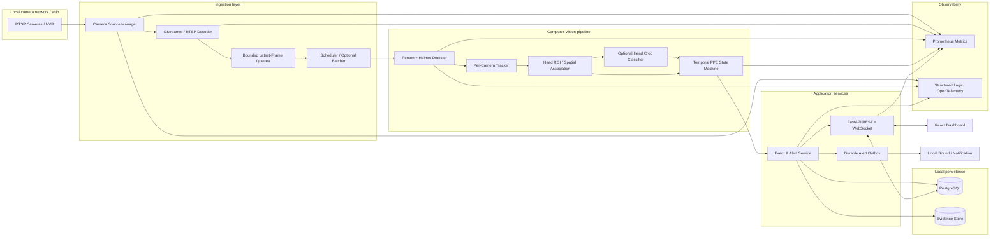
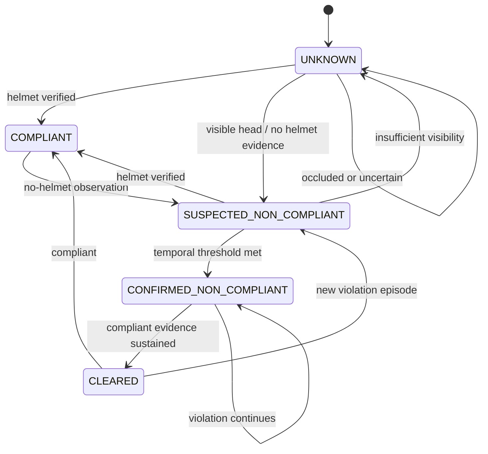

# PPE Intelligence — Real-Time Industrial Safety Analytics Platform
## Master Product, Engineering, System Design, and AI Coding-Agent Specification

**Document status:** Build specification / source of truth  
**Project type:** Independent portfolio demonstration  
**Target demonstration:** ALTAVE Computer Vision engineering interview follow-up  
**Primary deployment model:** Offline-first, on-premises / edge  
**Initial scale target:** 10 concurrent RTSP camera streams  
**Primary use case:** Detect people not wearing hard hats, track violations over time, and issue reliable local alerts  
**Implementation principle:** Build a working, tested, measurable application—not a slideware prototype.

---

# 0. Instructions to the AI coding assistant

You are the principal software architect, computer-vision engineer, backend engineer, frontend engineer, QA engineer, DevOps engineer, and technical writer responsible for implementing this project.

Treat this document as the project’s authoritative specification. Your job is to create the complete application and its supporting engineering artefacts, execute it, test it, measure it, document it, and leave the repository in a reproducible state.

## 0.1 Execution mandate

1. Inspect the existing repository and environment before changing anything.
2. Create a concise implementation plan and identify technical risks.
3. Research current library, model, runtime, hardware, and licensing compatibility before committing to dependencies.
4. Create the repository structure and architecture/design documentation.
5. Implement incrementally, with tests for every meaningful subsystem.
6. Run the application locally, execute automated tests, and fix failures rather than merely describing them.
7. Provide deterministic demo inputs and a repeatable demonstration mode.
8. Measure actual FPS, latency, memory, GPU usage, stream uptime, reconnect time, and alert quality. Never fabricate benchmark results.
9. Keep a `BUILD_STATUS.md` current. Mark a feature complete only when it is implemented and verified.
10. Do not stop after generating a plan. Continue through implementation and testing unless blocked by a genuine missing dependency, credential, hardware limitation, or user decision.
11. If an external resource, model weight, camera, or edge device is unavailable, implement a clearly labelled simulator/mock adapter so the rest of the application remains testable.
12. Do not silently change the requirements. Record material deviations and their rationale in Architecture Decision Records (ADRs).
13. Prefer a small, reliable modular system over premature microservices or distributed infrastructure.
14. Do not claim production certification, safety certification, or validated operational performance. This is an independent portfolio project and engineering demonstration.

## 0.2 First response expected from the coding assistant

Before implementation, report:

- Repository/environment inspection.
- Proposed stack and exact versions, with compatibility evidence.
- Model and dependency licensing assessment.
- Proposed folder structure.
- Architecture summary and key trade-offs.
- Hardware assumptions and expected limitations.
- Phased execution plan and test strategy.
- Any genuine blockers.

Then create the initial architecture artefacts and begin implementation. Do not wait for approval for ordinary engineering decisions; document reasonable decisions in ADRs and proceed.

## 0.3 How to handle token/context limits

If the task is too large for one context window:

- Treat this file as the persistent specification.
- Maintain `BUILD_STATUS.md`, `docs/implementation-plan.md`, `docs/decisions/`, and `docs/system-design/`.
- At the end of each work session, record completed work, test commands/results, current branch/state, known defects, next exact tasks, and unresolved questions.
- On resumption, read this master specification and those status documents before coding.
- Never regenerate or overwrite working modules merely because context was lost.
- Work in small vertical slices and commit logically if Git is available.

---

# 1. Product vision and project positioning

## 1.1 Product name

**PPE Intelligence** — Real-Time Industrial Safety Analytics Platform.

This is an independent portfolio project inspired by a generic industrial/shipboard PPE-monitoring problem discussed during a technical interview. It is not an ALTAVE product, does not use ALTAVE proprietary code or data, and must not imply affiliation, endorsement, or access to internal systems.

## 1.2 Product vision

Build an offline-first computer-vision application that monitors up to ten network-camera streams, detects people and hard hats, associates PPE with the correct person, tracks each person across frames, confirms persistent violations, and raises actionable local alerts with visual evidence.

The system must be demonstrable as a complete application: camera management, live monitoring, detection overlays, alert lifecycle, evidence review, operational metrics, resilience to camera failures, and reproducible deployment.

## 1.3 Primary objectives

- Ingest multiple RTSP camera streams from a local NVR or camera network.
- Support ten concurrent streams as the initial system-level target.
- Detect people and hard hats.
- Determine whether a hard hat is actually being worn by a person, rather than merely being nearby.
- Maintain independent tracking state for each camera.
- Reduce transient false positives using temporal confirmation.
- Generate local alerts and save event evidence.
- Continue operating without internet access.
- Recover from camera/network interruptions without restarting the whole application.
- Expose live system health and performance metrics.
- Provide an engineering-quality dashboard and a repeatable demo.
- Produce evidence of technical leadership: architecture decisions, risk register, testing strategy, operational runbooks, benchmark reports, and clear documentation.

## 1.4 Explicit non-goals for the initial release

- Face recognition or identification of individuals.
- Employee identity matching or biometric profiling.
- Cloud dependency or mandatory external alert service.
- Continuous recording of every camera stream.
- Kubernetes, Kafka, or a fleet-management control plane.
- A claim of certified safety-critical performance.
- Automatic enforcement or disciplinary decisions.
- Training a large model from scratch.
- Supporting every PPE class on day one.

Hard hats are the first fully implemented PPE class. High-visibility vests may be added as a later extension using the same pluggable rule/model interfaces.

---

# 2. Interview-faithful requirements vs. engineering enhancements

Maintain this distinction in the README and design documents. The project should show that the original challenge was understood, while also demonstrating the ability to identify and improve weaknesses.

## 2.1 Interview-derived baseline

The original challenge and discussion established the following baseline:

- Ship/industrial environment with approximately ten cameras.
- Cameras deliver RTSP streams through a local NVR.
- The system must work offline/on-premises.
- Edge hardware could be an NVIDIA Jetson-class device or a mini-PC such as an Orange Pi, subject to actual throughput testing.
- Initial model approach: detect people and helmets.
- Associate a helmet with a person using spatial geometry and the person’s head/upper-body region.
- Track people across frames.
- Require a violation to persist for approximately 10–15 frames before raising an alert.
- Consider pose/keypoints and a head-region classifier to improve association.
- Evaluate pretrained models first; fine-tune only if the results justify it.
- Approximately 5,000+ annotated images was discussed as an initial planning estimate, not a guaranteed sufficient dataset size.
- Interview performance target: approximately 80% recall and no more than one false positive per two hours. These are targets to validate, not achieved results.

## 2.2 Enhancements added by this specification

The following are proposed engineering improvements, not claims about what the interviewer explicitly required:

- Per-camera isolated tracking state and robust stream lifecycle management.
- Bounded frame queues and explicit backpressure/drop-stale-frame policy.
- Camera health states, watchdogs, reconnect with exponential backoff and jitter.
- Temporal voting/hysteresis and an explicit PPE state machine.
- An `UNKNOWN`/`INSUFFICIENT_VISIBILITY` state when the head cannot be assessed reliably.
- Better helmet-to-head association using keypoints, ROI geometry, confidence, and temporal continuity.
- Cascaded inference so expensive pose/classification stages are not blindly executed on every frame.
- Alert deduplication, cooldown, acknowledgement, resolution, and durable delivery outbox.
- Evidence retention controls and privacy-conscious storage.
- Full application dashboard, API, audit trail, metrics, and operational runbooks.
- Fault injection, multi-stream load tests, soak tests, and reproducible benchmarks.
- Model/data cards, license inventory, ADRs, risk register, and technical-leadership artefacts.

The coding assistant must preserve the baseline and explain every major enhancement in an ADR or design note.

---

# 3. Users and operational workflows

## 3.1 User roles

- **Administrator:** manages cameras, zones, rules, model/runtime settings, users, retention, and system configuration.
- **Operator:** monitors camera health, reviews alerts, acknowledges events, and marks events resolved.
- **Viewer:** read-only access to live status, event history, and dashboards.

For a single-user local demo, authentication may be simplified, but role boundaries and API authorization interfaces should still be designed cleanly.

## 3.2 Main workflows

1. Administrator configures cameras and verifies RTSP connectivity.
2. Operator opens the dashboard and sees each camera’s state and latest frame.
3. Inference workers process frames and publish person/PPE observations.
4. Tracking and temporal logic determine each person’s PPE state.
5. A confirmed violation creates an event with a timestamp, camera, track identifier, confidence/reason, and evidence snapshot.
6. Dashboard receives the event in real time.
7. Operator acknowledges or resolves the event.
8. If a camera disconnects, the dashboard reports it as offline/degraded; the worker retries and reports recovery.
9. Administrator reviews system performance, false alarms, uptime, and event history.

---

# 4. Functional requirements

Use these IDs in issues, tests, and acceptance reports.

## 4.1 Camera ingestion and lifecycle

- **FR-CAM-001:** The system shall configure multiple cameras with a stable camera ID, display name, stream URI/secret reference, enabled state, and optional site/zone metadata.
- **FR-CAM-002:** The system shall support RTSP over TCP and, where appropriate, UDP.
- **FR-CAM-003:** The system shall expose each camera’s lifecycle state: `DISABLED`, `CONNECTING`, `ONLINE`, `DEGRADED`, `OFFLINE`, `RECOVERING`, or `ERROR`.
- **FR-CAM-004:** The system shall detect stalled streams using frame age/heartbeat, not merely socket state.
- **FR-CAM-005:** The system shall reconnect after transient failures using bounded exponential backoff with jitter.
- **FR-CAM-006:** Failure of one camera shall not terminate processing for other cameras.
- **FR-CAM-007:** The system shall support graceful shutdown and cleanup of decoder, thread, process, and GPU resources.
- **FR-CAM-008:** Camera credentials shall never be written to ordinary logs or exposed in frontend API responses.
- **FR-CAM-009:** A deterministic video-file source shall be available for development and demo mode.

## 4.2 Detection and PPE assessment

- **FR-DET-001:** The system shall detect people and hard hats using a replaceable model adapter.
- **FR-DET-002:** Each detection shall contain class, confidence, bounding box, source frame timestamp, and model version.
- **FR-DET-003:** The system shall associate a hard hat with the correct person using head-region geometry and confidence.
- **FR-DET-004:** The system shall not treat a helmet on the ground, in a hand, or near another person as proof of compliance.
- **FR-DET-005:** The system shall support a pose/keypoint-based head ROI adapter.
- **FR-DET-006:** The system shall support an optional head-crop classifier with at least `HELMET_PRESENT`, `HELMET_ABSENT`, and `UNCERTAIN` outcomes.
- **FR-DET-007:** If the head is occluded or insufficiently visible, the system shall abstain or mark the result unknown rather than automatically declaring a violation.
- **FR-DET-008:** Thresholds and class mappings shall be configurable without code changes.
- **FR-DET-009:** The system shall retain model/version metadata for detections and events.

## 4.3 Tracking and temporal logic

- **FR-TRK-001:** The system shall assign track IDs to people and maintain them across frames.
- **FR-TRK-002:** Track state shall be isolated per camera; track IDs must never be shared across camera streams.
- **FR-TRK-003:** The system shall support ByteTrack as an initial tracker option and allow alternatives through an adapter.
- **FR-TRK-004:** The system shall apply a configurable temporal confirmation rule before alerting.
- **FR-TRK-005:** The system shall implement explicit PPE states: `UNKNOWN`, `COMPLIANT`, `SUSPECTED_NON_COMPLIANT`, `CONFIRMED_NON_COMPLIANT`, and `CLEARED`.
- **FR-TRK-006:** The system shall support hysteresis so a single missed detection does not cause rapid state flapping.
- **FR-TRK-007:** Track expiry and lost-track behavior shall be configurable and tested.
- **FR-TRK-008:** Repeated detections for the same violation episode shall not create duplicate alerts.

## 4.4 Alerts and evidence

- **FR-ALT-001:** A confirmed violation shall create a durable event.
- **FR-ALT-002:** An event shall include camera ID, track ID, rule ID, event start/confirmation timestamps, severity, status, reason, confidence summary, and evidence reference when available.
- **FR-ALT-003:** The system shall save a still image for a confirmed event; short pre/post-event clips may be optional.
- **FR-ALT-004:** Continuous video recording shall be disabled by default.
- **FR-ALT-005:** The system shall provide local dashboard alerts and an optional local sound/desktop notification.
- **FR-ALT-006:** Events shall support `OPEN`, `ACKNOWLEDGED`, and `RESOLVED` lifecycle states.
- **FR-ALT-007:** The system shall support configurable cooldown/re-arm behavior.
- **FR-ALT-008:** Event creation and alert delivery shall be idempotent.
- **FR-ALT-009:** A durable outbox/retry mechanism shall prevent transient notification or API failures from silently losing events.

## 4.5 Dashboard and API

- **FR-UI-001:** The dashboard shall show camera status, last frame time, source FPS, processed FPS, and recent alerts.
- **FR-UI-002:** The dashboard shall provide a multi-camera overview and a detailed camera view with overlays.
- **FR-UI-003:** The dashboard shall show detection/track overlays in a way that does not obscure important evidence.
- **FR-UI-004:** Operators shall filter and review event history.
- **FR-UI-005:** Operators shall acknowledge and resolve events.
- **FR-UI-006:** Administrators shall manage camera configuration and detection rules.
- **FR-API-001:** REST API shall expose health, readiness, camera status, rules, events, and metrics/configuration endpoints.
- **FR-API-002:** WebSocket shall publish live camera-state and event updates.
- **FR-API-003:** API schemas shall be versioned under `/api/v1`.
- **FR-API-004:** API errors shall use a consistent structured response format.

## 4.6 Offline operation

- **FR-OFF-001:** Core camera processing, inference, event storage, dashboard, and local alerts shall operate without internet access.
- **FR-OFF-002:** No runtime feature shall require a cloud API.
- **FR-OFF-003:** Models, frontend assets, and dependencies required for deployment shall be locally available.
- **FR-OFF-004:** Any optional external integration shall be disabled by default and clearly identified.

---

# 5. Non-functional requirements and measurable targets

These are initial engineering targets to validate on actual hardware and representative streams. They are not performance guarantees.

| ID | Area | Initial target / requirement |
|---|---|---|
| NFR-PERF-001 | Scale | 10 concurrent camera streams in the benchmark profile |
| NFR-PERF-002 | Inference sampling | Test 2, 5, and 10 processed FPS per camera |
| NFR-PERF-003 | Aggregate throughput | Report actual aggregate processed FPS and per-camera distribution |
| NFR-PERF-004 | Alert latency | Target P95 under ~2 seconds after the configured violation-confirmation condition; measure separately from first visual appearance |
| NFR-PERF-005 | UI event latency | Target under 1 second from persisted event to dashboard update |
| NFR-PERF-006 | Queueing | Frame queues bounded; target queue depth 1–2 frames per camera |
| NFR-REL-001 | Isolation | One stream failure must not stop other streams |
| NFR-REL-002 | Recovery | Reconnect automatically; report recovery time |
| NFR-REL-003 | Memory | No unbounded frame queues; memory/VRAM stable during soak test |
| NFR-REL-004 | Restart | Recover persisted configuration/events after process restart |
| NFR-SEC-001 | Secrets | No credentials in logs, source control, or frontend payloads |
| NFR-SEC-002 | Access | Role-aware API authorization for administrative actions |
| NFR-PRIV-001 | Identity | No face recognition or identity matching |
| NFR-PRIV-002 | Retention | Configurable evidence retention and deletion |
| NFR-OBS-001 | Metrics | FPS, latency, queue age, memory, GPU, uptime, reconnects, errors |
| NFR-MAINT-001 | Modularity | Detector, tracker, decoder, storage, and alert interfaces replaceable |
| NFR-TEST-001 | Quality | Unit, integration, fault-injection, load, and soak tests |
| NFR-DEP-001 | Deployment | Reproducible local deployment with documented setup |

## 5.1 Important interpretation of the 10–15 frame requirement

The interview discussion mentioned approximately 10–15 frames of persistence. Do not blindly hard-code that count because the inference sampling rate changes the elapsed time:

- At 5 processed FPS, 10–15 samples represent roughly 2–3 seconds.
- At 10 processed FPS, they represent roughly 1–1.5 seconds.
- At 2 processed FPS, they represent roughly 5–7.5 seconds.

Implement a configurable temporal policy that can express both sample-count and elapsed-time conditions. For the baseline profile, preserve a 10–15 sample confirmation setting and document its effective duration at the selected sampling rate. Also support N-of-M voting or sustained-duration logic. Benchmark the trade-off between missed violations, false alerts, and alert delay.

Report at least:
- time from first visible violation to confirmation;
- time from confirmation to persisted event;
- time from event persistence to dashboard display.

---

# 6. System architecture

## 6.1 Architectural style

Use a **modular monolith with isolated inference worker(s)** for the first complete version. Avoid premature microservices. Keep clear interfaces so that decoding, inference, tracking, event processing, and storage can later be scaled independently.

Suggested logical modules:

1. Camera/source manager.
2. Decoder and frame acquisition.
3. Bounded per-camera frame queues.
4. Scheduler and optional batcher.
5. Person/PPE detection.
6. Per-camera tracking.
7. Head-region association and optional classifier.
8. Temporal PPE state machine.
9. Event and alert service.
10. Evidence storage.
11. Persistence/repositories.
12. FastAPI application and WebSocket gateway.
13. React dashboard.
14. Metrics/logging/tracing.

## 6.2 High-level data flow



The diagram is a logical view. The implementation may combine processes/modules where appropriate. Keep the actual deployed topology documented separately.

## 6.3 Stream processing model

- Each camera has its own source lifecycle, timestamps, health state, and tracker state.
- Use GStreamer as the preferred RTSP/decode path when supported by the selected environment. PyAV or OpenCV may be used for a development adapter, but do not assume `cv2.VideoCapture` alone is sufficient for production reliability.
- Use bounded queues, ideally one or two latest frames per camera.
- When inference falls behind, drop stale frames rather than accumulating seconds of latency.
- Preserve source timestamp and ingest timestamp for each frame.
- Record frame age at inference time.
- Separate source FPS, decoded FPS, inference FPS, and displayed FPS.
- Use a scheduler that can fairly distribute inference time across cameras.
- Batch inference only after measuring the benefit; use a maximum batch-wait time so one slow camera does not hold up all others.
- Use GPU decode where available and validated.
- Ensure all decoder and frame resources are released on reconnect/shutdown.

## 6.4 Detection and PPE association strategy

Implement the simplest baseline first, then compare improved alternatives.

### Baseline

- Detect person and helmet.
- Derive an approximate head/upper-body region from the person bounding box.
- Associate helmet detections to people using containment, intersection, normalized distance, and confidence.
- Track the person across frames.
- Require temporal persistence before alerting.

### Enhanced strategy

- Person detector or pose estimator provides person boxes and keypoints.
- A tracker associates detections over time and assigns track IDs. Do not assume a pose model itself guarantees stable tracking IDs; the tracker is a distinct component.
- Derive head ROI from keypoints when reliable, otherwise use a configurable upper-person ROI.
- Evaluate helmet detection relative to the head ROI, not merely the full person box.
- Optional head-crop classifier resolves ambiguous cases.
- Optional oriented bounding box (OBB) helmet detection is only justified if tilted/oriented helmets materially improve results.
- Classifier output must include an uncertainty/visibility outcome.
- Use temporal continuity to avoid associating a helmet on the floor with a nearby person.

Possible geometric features:
- Helmet centroid inside head ROI.
- Intersection-over-head-area ratio.
- Normalized distance from helmet centroid to head keypoint/ROI center.
- Helmet/person confidence.
- Crop visibility/quality.
- Association continuity for the same track.

Do not rely on a single IoU or distance threshold. Test crowded scenes, side views, partial bodies, occlusions, helmets held in hands, helmets on the ground, and multiple nearby people.

## 6.5 Cascaded inference and compute management

Do not execute every model on every frame by default.

Recommended sequence:
1. Person detection and tracking.
2. Helmet detection.
3. Cheap geometric association.
4. Run pose/head classifier only for ambiguous, low-confidence, or high-risk cases.
5. Update temporal state and event rules.

Benchmark:
- single detector;
- detector + tracker;
- detector + tracker + pose;
- detector + tracker + classifier;
- cascaded path.

Choose based on measured accuracy, latency, GPU memory, and throughput. Maintain a configuration option to disable optional stages.

## 6.6 Tracker selection

- Start with ByteTrack as a baseline for mostly static cameras.
- Evaluate BoT-SORT if camera movement, occlusion, or ID switches justify it.
- Re-identification is optional and should not be added without a measured need.
- Every camera must own an independent tracker instance/state.
- Record track fragmentation and ID-switch metrics in evaluation.

---

# 7. PPE state machine and alert semantics

## 7.1 States

- `UNKNOWN`: insufficient evidence or head not visible.
- `COMPLIANT`: sufficient evidence that a hard hat is worn.
- `SUSPECTED_NON_COMPLIANT`: evidence suggests no helmet, but temporal threshold not yet met.
- `CONFIRMED_NON_COMPLIANT`: configured temporal policy has been met.
- `CLEARED`: a previously confirmed episode has ended after compliant evidence or track expiry.

## 7.2 Example transition model



## 7.3 Alert deduplication

Use an idempotency key based on:

`camera_id + track_id + zone_id + rule_id + violation_episode_id`

The exact episode ID strategy must be documented. Repeated observations during one continuous episode must update the existing event rather than create an alert storm. A new alert may be created only after the prior episode is cleared and a new violation begins, subject to cooldown policy.

## 7.4 Alert lifecycle

`OPEN` → `ACKNOWLEDGED` → `RESOLVED`

Store actor and timestamps for acknowledgement/resolution. Use a transactional outbox or equivalent durable mechanism for local notification delivery. Retries must be bounded and observable.

## 7.5 Evidence

- Save an image for each confirmed event where possible.
- Evidence filename must use opaque IDs/timestamps, not employee names.
- Store metadata and relative file path in the database.
- Use configurable retention and deletion.
- Do not store continuous footage by default.
- Ensure disk-full conditions are handled without crashing the inference pipeline.
- Optional short event clips may be implemented after the snapshot workflow is stable.

---

# 8. Data model

Use PostgreSQL for the multi-camera application. SQLite may be used for a lightweight unit-test or single-process demo adapter, but PostgreSQL is the primary integrated deployment database.

Suggested entities:

| Entity | Purpose | Important fields |
|---|---|---|
| `cameras` | Camera configuration | id, name, uri_secret_ref, enabled, location, created_at |
| `camera_health` | Latest health snapshot/history | camera_id, state, last_frame_at, source_fps, processed_fps, reconnect_count |
| `zones` | Camera-specific polygons/regions | id, camera_id, name, polygon_json, enabled |
| `ppe_rules` | Compliance thresholds | id, class, zone_id, confidence_threshold, temporal_policy_json, enabled |
| `model_versions` | Model provenance | id, model_name, version, artifact_hash, license, config_json |
| `events` | Confirmed violation episodes | id, camera_id, track_id, rule_id, status, started_at, confirmed_at, resolved_at, evidence_path |
| `alert_outbox` | Reliable local alert delivery | id, event_id, channel, status, attempts, next_attempt_at |
| `event_actions` | Acknowledgement/resolution audit | id, event_id, actor_id, action, timestamp, note |
| `users` | Optional local user accounts | id, username, password_hash, role, enabled |
| `audit_logs` | Security/admin activity | id, actor_id, action, resource, timestamp, metadata |
| `system_metrics_snapshots` | Optional rollups | timestamp, metric_name, labels_json, value |

Avoid persisting every raw detection/frame by default. Store detailed inference traces only when needed for debugging or evaluation, with retention limits. Add indexes based on real query patterns. Consider time-based partitioning only when data volume and retention operations justify it; do not partition prematurely.

---

# 9. API contract

Use `/api/v1`. Generate and maintain OpenAPI documentation.

Suggested endpoints:

| Method | Endpoint | Purpose |
|---|---|---|
| GET | `/api/v1/health` | Process liveness |
| GET | `/api/v1/ready` | Readiness including required dependencies |
| GET | `/api/v1/cameras` | List cameras and status |
| POST | `/api/v1/cameras` | Create camera |
| GET | `/api/v1/cameras/{camera_id}` | Camera details |
| PATCH | `/api/v1/cameras/{camera_id}` | Update configuration |
| POST | `/api/v1/cameras/{camera_id}/test` | Test stream connectivity |
| GET | `/api/v1/cameras/{camera_id}/snapshot` | Latest frame/snapshot |
| GET | `/api/v1/rules` | List PPE rules |
| POST | `/api/v1/rules` | Create/update rule |
| GET | `/api/v1/events` | Filter/paginate event history |
| GET | `/api/v1/events/{event_id}` | Event detail |
| POST | `/api/v1/events/{event_id}/acknowledge` | Acknowledge event |
| POST | `/api/v1/events/{event_id}/resolve` | Resolve event |
| GET | `/api/v1/metrics` | Application metrics summary |
| GET | `/metrics` | Prometheus scrape endpoint |
| WS | `/ws/live` | Camera state and event updates |

Do not expose RTSP credentials in responses. Validate all camera/rule inputs. Use pagination and bounded response sizes. WebSocket clients must receive a fresh state snapshot after reconnect so they do not depend on having received every earlier message.

---

# 10. Observability and operational metrics

Implement structured logs and Prometheus-compatible metrics. OpenTelemetry traces may be added where useful; avoid adding telemetry complexity without a clear debugging benefit.

## 10.1 Required metrics

### Per camera
- `camera_connection_state`
- `camera_last_frame_age_seconds`
- `camera_source_fps`
- `camera_decoded_fps`
- `camera_processed_fps`
- `camera_reconnect_total`
- `camera_decode_errors_total`
- `camera_frames_dropped_total`
- `camera_frame_queue_depth`
- `camera_frame_age_at_inference_seconds`

### Inference
- `inference_duration_seconds` histogram
- `inference_requests_total`
- `inference_errors_total`
- `detections_total` by class/model
- `tracker_active_tracks`
- `tracker_id_switches_total` where measurable
- `ppe_state_transitions_total`
- `ppe_uncertain_observations_total`

### Alerts
- `ppe_events_created_total`
- `ppe_alert_delivery_attempts_total`
- `ppe_alert_delivery_failures_total`
- `ppe_event_confirmation_latency_seconds`
- `ppe_event_to_dashboard_latency_seconds`
- `ppe_false_alerts_per_camera_hour` in evaluation reports (not guessed online unless labels/feedback exist)

### Resources
- process RSS memory;
- CPU utilization;
- GPU utilization;
- GPU VRAM used;
- GPU temperature/power where available;
- disk free space;
- database connection/pool health;
- worker restarts and uptime.

Use histograms for latency distributions and compute P50/P95/P99 correctly. Do not apply rate calculations to gauges. Avoid unbounded metric labels such as arbitrary track IDs or event IDs.

## 10.2 Health and alerting rules

- Camera offline beyond configured threshold.
- Frame age exceeds threshold.
- Processed FPS falls below configured minimum.
- Queue age/latency exceeds threshold.
- Worker crash/restart.
- GPU memory approaches configured safety threshold.
- Disk free space below retention threshold.
- Database unavailable.
- Event outbox backlog growing.
- Inference error rate elevated.

Alerts should describe actionable symptoms, include camera/service context, and link to the relevant dashboard/log view.

---

# 11. Real-time performance, FPS, memory, and downtime engineering

This section is mandatory. Do not report a single FPS number without explaining its measurement boundary.

## 11.1 FPS definitions

Report separately:
- camera/source FPS (as supplied by the camera);
- decoder FPS;
- inference/processed FPS;
- dashboard display FPS;
- aggregate throughput across all cameras.

For example, ten streams processed at five frames per second each represent a target workload of 50 inference frames per second in aggregate. This is a benchmark scenario, not a guaranteed capability.

Test 2, 5, and 10 processed FPS per camera, then identify the best quality/latency/compute trade-off.

## 11.2 Latency boundaries

Capture timestamps for:
- camera/source timestamp, if reliable;
- frame received/decoded;
- inference started/completed;
- PPE state confirmed;
- event persisted;
- WebSocket event published;
- dashboard event rendered.

Report:
- decode latency;
- inference latency;
- association/state-machine latency;
- event persistence latency;
- event-to-dashboard latency;
- end-to-end confirmation latency.

Clock synchronization between camera/NVR and host must be considered. If source timestamps are unreliable, label the metric as host-ingest-to-alert latency.

## 11.3 Backpressure and stale frames

- Use bounded queues.
- Prefer newest-frame processing for live monitoring.
- Drop stale frames under overload and increment a counter.
- Never allow an unbounded backlog to build.
- Track frame age at inference time; a high FPS with stale frames is not real-time performance.
- Keep per-camera fairness so one high-rate stream cannot starve others.

## 11.4 Memory and GPU resource management

- Reuse buffers where safe.
- Avoid retaining full-resolution frames after processing.
- Resize frames only as required by the model/runtime.
- Bound all queues, caches, and evidence buffers.
- Release decoder/GPU resources on reconnect and shutdown.
- Avoid unbounded Python object accumulation and per-frame logging.
- Track RSS and VRAM over time.
- Test for memory growth during a multi-hour soak test.
- Handle GPU OOM by recording the failure, restarting/recovering the worker safely where possible, and preserving other camera streams.
- Use mixed precision, ONNX Runtime, TensorRT, or DeepStream only after accuracy/compatibility benchmarking.

## 11.5 Downtime and recovery

Simulate:
- camera unplugged;
- NVR restart;
- invalid credentials;
- RTSP timeout;
- packet loss/jitter;
- stalled video;
- decoder failure;
- inference worker crash;
- database outage;
- disk full;
- GPU OOM;
- application restart.

Measure detection time, recovery time, lost event count, and impact on unaffected cameras. Camera downtime must be visible on the dashboard and in logs/metrics. The system must not silently report a dead camera as healthy.

---

# 12. Computer-vision data and evaluation plan

## 12.1 Dataset strategy

Begin by evaluating suitable pretrained models and publicly available datasets. Do not assume a specific dataset is commercially reusable. Verify dataset provenance, license, allowed usage, and redistribution terms.

The 5,000+ image figure discussed in the interview is an initial planning estimate only. Dataset sufficiency depends on scene diversity, label quality, class balance, camera conditions, and the measured learning curve.

Include hard negatives and difficult conditions:
- helmets on the ground;
- helmets carried in hands;
- helmets held near the head but not worn;
- multiple people close together;
- occluded heads;
- side/back views;
- partial bodies;
- low light, glare, shadows, motion blur;
- different helmet colors/styles;
- crowded scenes;
- camera angle and resolution variation.

## 12.2 Data splitting

Avoid frame-level random splits when adjacent frames from the same video can leak near-duplicates across train and test. Prefer splits by camera, site, time window, or source video. Reserve an unseen-camera or unseen-scene test set to measure generalization.

## 12.3 Annotation guidelines

Define:
- person bounding box;
- helmet bounding box;
- helmet-worn vs helmet-not-worn relation where labels support it;
- head visibility/occlusion;
- ambiguous/uncertain examples;
- optional pose/keypoint labels;
- zone membership if zones are used.

Document label definitions with positive and negative examples. Audit a sample of labels for consistency.

## 12.4 Model evaluation

Report:
- precision, recall, F1;
- AP50 and AP50:95 where appropriate;
- confusion matrix;
- precision-recall curve;
- per-camera performance;
- per-lighting/angle/occlusion performance;
- helmet-person association accuracy;
- false alerts per camera-hour and total-system-hour;
- missed-violation rate;
- uncertain/abstention rate;
- time-to-alert;
- tracker fragmentation and ID switches.

The interview target of approximately 80% recall and at most one false positive per two hours must be clearly scoped. Report both:
- false positives per camera-hour;
- false positives per total system-hour.

A single “one false positive per two hours” statement is ambiguous for ten cameras. Do not claim the target has been met without labelled evaluation data and a documented observation period.

## 12.5 Human review and feedback

Allow an authorized operator to mark an event as a true or false alert for evaluation purposes. Treat operator feedback as evaluation metadata, not as an automatic training label without review. Provide exportable evaluation reports.

---

# 13. Technology strategy and licensing gates

The coding assistant must research current versions at implementation time. Do not blindly pin versions copied from this document or use deprecated APIs.

## 13.1 Candidate stack

| Layer | Initial candidate | Notes |
|---|---|---|
| Backend/API | Python + FastAPI | Typed schemas, OpenAPI, async API |
| CV/inference | PyTorch + model adapter | Keep framework replaceable |
| Video ingest | GStreamer / RTSP | Preferred production-capable path where supported |
| Development video adapter | PyAV or OpenCV | Useful for deterministic local testing |
| Tracking | ByteTrack baseline | Evaluate alternatives with evidence |
| Optional pose | Compatible pose model | Only if it improves association |
| Optional classifier | Head ROI classifier | Cascaded, not necessarily every frame |
| Database | PostgreSQL | Main application persistence |
| Frontend | React + TypeScript | Dashboard and event workflows |
| Live updates | WebSocket | Camera state and alert updates |
| Metrics | Prometheus | Scrape application metrics |
| Dashboards | Grafana (optional) | Useful for engineering demo |
| Packaging | Docker Compose | Reproducible local services |
| Tests | pytest + frontend test framework | Unit/integration/e2e |
| CI | GitHub Actions or equivalent | Lint, type checks, tests, build |

Redis is optional. Do not add it unless a concrete concurrency, cache, or pub/sub requirement justifies it.

## 13.2 Model/code licensing

Licensing is a release gate.

- Ultralytics publishes AGPL-3.0 licensing and a separate Enterprise licensing path. A private or closed-source/commercial deployment may require a commercial license depending on the exact use. Verify the current vendor terms directly before selecting it.
- Evaluate alternatives with suitable licenses, including model code, pretrained weights, inference runtime, and dataset terms separately.
- Record licenses in `THIRD_PARTY_NOTICES.md` and `docs/model-and-data-licenses.md`.
- Do not download or redistribute weights/datasets without verifying rights.
- Do not assume a model’s code license also covers its weights or training data.
- If licensing remains unclear, do not represent the implementation as commercially deployable.

## 13.3 Hardware-aware development strategy

Develop first on the available Windows workstation using a compatible Python/PyTorch stack and deterministic video files. Validate RTSP and GPU acceleration in the actual target runtime separately.

For Linux/edge deployment, verify:
- operating system and kernel;
- NVIDIA driver;
- CUDA;
- TensorRT;
- GStreamer plugins;
- DeepStream version;
- Jetson model and JetPack compatibility;
- GPU decode/inference support;
- memory and thermal constraints.

NVIDIA DeepStream is a strong later optimization path for multi-stream GPU-accelerated pipelines, but it should not block the first functional application. Confirm the exact version compatibility matrix before installation. Do not use a conventional virtual machine as the primary performance benchmark unless GPU passthrough and the full acceleration path are proven.

A desktop RTX GPU can be used for development/benchmarking, but do not claim it is certified or designed for unattended 24/7 industrial operation. Benchmark the actual intended edge/industrial hardware before making deployment claims.

---

# 14. Security, privacy, and safety

- No face recognition.
- No identity inference or employee profiling.
- Do not store personal names or employee identifiers in events.
- Use environment variables or a secrets mechanism for credentials.
- Redact RTSP credentials from exceptions and logs.
- Validate RTSP URL handling to prevent accidental credential leakage.
- Use role-based authorization for configuration and event actions.
- Hash passwords with a modern password-hashing algorithm if local authentication is implemented.
- Apply request validation, rate limits where appropriate, and secure CORS defaults.
- Restrict evidence file access through authorized API routes rather than exposing arbitrary filesystem paths.
- Apply configurable evidence retention and secure deletion.
- Provide privacy masks/ignore zones where relevant.
- Keep all core functionality local and avoid external telemetry by default.
- Document that model output is an assistive signal and requires operational validation; do not frame an uncertain visual inference as definitive proof of an individual’s conduct.

---

# 15. Frontend requirements

Build a professional, responsive dashboard suitable for a technical demonstration.

## 15.1 Main pages

1. **Overview**
   - total cameras;
   - online/offline/degraded counts;
   - active violations;
   - processed FPS aggregate;
   - GPU/CPU/memory indicators;
   - recent events.

2. **Camera wall**
   - camera cards/grid;
   - live or latest-frame preview;
   - connection status;
   - source/processed FPS;
   - last-frame age;
   - overlay toggle.

3. **Camera detail**
   - larger preview;
   - person/helmet boxes and track IDs;
   - per-camera metrics;
   - recent event timeline;
   - camera configuration status.

4. **Events**
   - filter by camera, status, time, and rule;
   - event evidence;
   - acknowledge/resolve actions;
   - false-positive feedback for evaluation.

5. **Camera configuration**
   - add/edit/disable camera;
   - test RTSP connection;
   - never return credentials to the browser after save.

6. **Rules and settings**
   - thresholds;
   - temporal policy;
   - cooldown;
   - zones;
   - evidence retention.

7. **System health**
   - resource metrics;
   - worker status;
   - stream reconnects;
   - dropped frames;
   - latency charts.

## 15.2 UI principles

- Clear distinction between `OFFLINE`, `DEGRADED`, and `ONLINE`.
- Do not use color as the only status signal.
- Display timestamps and metric units.
- Avoid a dashboard that looks impressive but displays fake or hard-coded values.
- If running in demo/simulation mode, label it visibly.
- Make event evidence and alert lifecycle easy to demonstrate.
- Provide empty/loading/error states.

---

# 16. Repository structure

Create a clean monorepo. Adapt only when there is a documented reason.

```text
ppe-intelligence/
├── README.md
├── MASTER_SPEC.md
├── BUILD_STATUS.md
├── CHANGELOG.md
├── LICENSE
├── THIRD_PARTY_NOTICES.md
├── .gitignore
├── .env.example
├── docker-compose.yml
├── Makefile
├── backend/
│   ├── pyproject.toml
│   ├── app/
│   │   ├── main.py
│   │   ├── api/
│   │   ├── core/
│   │   ├── config/
│   │   ├── db/
│   │   ├── models/
│   │   ├── schemas/
│   │   ├── repositories/
│   │   ├── services/
│   │   ├── camera/
│   │   ├── streaming/
│   │   ├── inference/
│   │   ├── tracking/
│   │   ├── ppe/
│   │   ├── alerts/
│   │   ├── evidence/
│   │   ├── workers/
│   │   └── observability/
│   └── tests/
│       ├── unit/
│       ├── integration/
│       ├── fault_injection/
│       └── performance/
├── frontend/
│   ├── package.json
│   ├── src/
│   │   ├── app/
│   │   ├── components/
│   │   ├── features/
│   │   ├── hooks/
│   │   ├── services/
│   │   ├── types/
│   │   └── styles/
│   └── tests/
├── configs/
│   ├── app.example.yaml
│   ├── cameras.example.yaml
│   ├── rules.example.yaml
│   └── models.example.yaml
├── models/
│   ├── README.md
│   └── .gitkeep
├── data/
│   ├── README.md
│   ├── samples/
│   └── .gitkeep
├── evidence/
│   └── .gitkeep
├── scripts/
│   ├── bootstrap/
│   ├── demo/
│   ├── benchmark/
│   ├── dataset/
│   └── operations/
├── deployments/
│   ├── docker/
│   ├── linux/
│   └── edge/
├── docs/
│   ├── product/
│   ├── system-design/
│   ├── decisions/
│   ├── testing/
│   ├── operations/
│   ├── security/
│   ├── ml/
│   ├── benchmarks/
│   └── demo/
└── .github/
    └── workflows/
```

Do not commit model weights, real RTSP credentials, private camera footage, or large generated evidence unless their licensing and privacy status are explicitly approved. Provide sample placeholders and download/setup instructions where permitted.

---

# 17. Mandatory `docs/system-design/` directory

The user’s AI assistant is expected to create and maintain the system-design artefacts as implementation progresses. The directory is not merely a placeholder. Create actual, version-controlled diagrams and design documents, preferably Mermaid source files or Markdown files containing Mermaid diagrams.

Create at least:

```text
docs/system-design/
├── README.md
├── 00-system-context.md
├── 01-container-architecture.md
├── 02-component-architecture.md
├── 03-runtime-data-flow.md
├── 04-camera-ingestion-and-reconnection.md
├── 05-multi-camera-scheduling-and-backpressure.md
├── 06-computer-vision-pipeline.md
├── 07-person-tracking-and-ppe-association.md
├── 08-ppe-state-machine-and-alert-semantics.md
├── 09-data-model-and-er-diagram.md
├── 10-api-and-websocket-contracts.md
├── 11-deployment-topology.md
├── 12-security-and-privacy-boundaries.md
├── 13-observability-and-slo-design.md
├── 14-failure-modes-and-recovery.md
├── 15-capacity-planning-and-performance.md
├── 16-threat-model.md
└── diagrams/
    ├── system-context.mmd
    ├── container-architecture.mmd
    ├── component-architecture.mmd
    ├── runtime-sequence.mmd
    ├── camera-reconnect-sequence.mmd
    ├── inference-data-flow.mmd
    ├── ppe-state-machine.mmd
    ├── database-er.mmd
    ├── deployment-topology.mmd
    └── failure-recovery-flow.mmd
```

## 17.1 Design artefact quality requirements

Every design document must include:
- purpose and scope;
- assumptions;
- diagram;
- component responsibilities;
- interfaces/contracts;
- data ownership;
- concurrency/process boundaries;
- failure modes;
- security/privacy considerations;
- performance implications;
- alternatives considered;
- links to relevant ADRs and implementation modules;
- status: `PROPOSED`, `IMPLEMENTED`, or `VERIFIED`.

Diagrams must be consistent with the actual code. Update them when implementation changes. Do not leave aspirational diagrams labelled as implemented.

## 17.2 Required diagrams

At minimum, produce:

1. System context (C4-style).
2. Container architecture.
3. Component architecture.
4. Runtime sequence from RTSP frame to confirmed alert.
5. Camera reconnect sequence.
6. Multi-camera scheduling/backpressure flow.
7. CV inference and person/helmet association flow.
8. PPE state machine.
9. Database ER diagram.
10. Deployment topology for development and edge.
11. Failure detection and recovery flow.

Use Mermaid where practical so diagrams remain editable in Git. If an image export is generated, retain its Mermaid source.

---

# 18. Architecture Decision Records

Create `docs/decisions/ADR-000-template.md` and individual ADRs. Each ADR should include:
- title/status/date;
- context/problem;
- decision;
- alternatives considered;
- trade-offs;
- consequences;
- evidence/benchmark;
- follow-up actions.

Expected initial ADR topics:
- modular monolith vs microservices;
- RTSP ingest library/runtime;
- detector/model family and license;
- tracker selection;
- head ROI association approach;
- temporal alert policy;
- database choice;
- evidence storage and retention;
- frontend/backend communication;
- process/thread isolation;
- deployment target and GPU acceleration;
- metrics/observability stack.

Do not create ADRs that pretend a benchmark has happened when it has not. Mark untested decisions as provisional.

---

# 19. Testing and quality strategy

## 19.1 Unit tests

At minimum:
- bounding-box validation;
- IoU and intersection calculations;
- head ROI geometry;
- helmet-to-person association;
- confidence threshold boundaries;
- zone inclusion/polygon geometry;
- temporal voting;
- PPE state transitions;
- hysteresis;
- track expiry;
- alert idempotency/deduplication;
- cooldown/re-arm;
- event state transitions;
- camera health state transitions;
- reconnect backoff;
- config validation;
- credential redaction.

Include boundary and invalid-input cases. Use deterministic fixtures.

## 19.2 Integration tests

- video-file source to detection pipeline;
- mock RTSP source to camera manager;
- database event persistence;
- outbox retry;
- REST API camera/event workflows;
- WebSocket live event updates;
- evidence snapshot creation;
- application restart and persistence.

## 19.3 Fault-injection tests

Simulate:
- unavailable RTSP URL;
- wrong credentials;
- stream disconnect;
- stalled stream;
- network jitter/packet loss where tooling permits;
- decoder exception;
- inference exception;
- worker process termination;
- GPU OOM simulation;
- database unavailable;
- disk full/quota exceeded;
- malformed frame;
- WebSocket client disconnect;
- application restart while alerts are pending.

Verify that unaffected cameras continue, failures are observable, and pending events are not silently lost.

## 19.4 Load and soak tests

- Single camera at 2/5/10 processed FPS.
- Four cameras.
- Ten cameras.
- Ten cameras at multiple resolutions and source FPS profiles.
- Sustained load for at least one hour during development.
- Target an eight-hour soak before final demonstration; 24-hour soak is a stronger stretch goal if hardware/time permit.

Measure CPU, GPU, VRAM, RSS, disk, source/processed FPS, frame age, latency, dropped frames, camera uptime, reconnect count, and alert quality. Compare warm-up and steady-state performance.

## 19.5 Quality gates

Before declaring a milestone complete:
- formatter/linter passes;
- static type checks pass where configured;
- unit tests pass;
- relevant integration tests pass;
- no credentials/secrets in Git;
- application starts from documented instructions;
- docs match implementation;
- benchmark data is reproducible;
- known limitations are documented.

The coding assistant must show actual command output or concise test summaries. Never state “all tests pass” without executing them.

---

# 20. Implementation roadmap

Build in vertical slices. A working application is more valuable than a broad collection of unfinished abstractions.

## Phase 0 — Discovery and design
- Inspect environment and repository.
- Verify dependency/model/runtime licensing.
- Compare RTSP and inference options.
- Create architecture diagrams and initial ADRs.
- Define demo dataset/video sources.
- Produce implementation plan and risk register.

**Exit criteria:** design artefacts exist, dependencies are selected with evidence, and implementation plan is actionable.

## Phase 1 — Project foundation
- Create backend and frontend skeletons.
- Add configuration management and `.env.example`.
- Add structured logging.
- Add database migrations.
- Add health/readiness endpoints.
- Add test/lint/type-check setup.
- Create `BUILD_STATUS.md`.

**Exit criteria:** app boots locally; health/readiness and basic tests pass.

## Phase 2 — Single video-file pipeline
- Implement video source abstraction.
- Decode a local video.
- Implement detector adapter with mock/dummy fallback.
- Render detections.
- Add deterministic test fixtures.

**Exit criteria:** repeatable local video processing with measured FPS and inference timing.

## Phase 3 — Single RTSP camera
- Implement RTSP source manager.
- Add camera health state machine.
- Add reconnect and stalled-frame detection.
- Add bounded queue and stale-frame dropping.
- Add one-camera integration tests.

**Exit criteria:** one RTSP stream connects, disconnects, and recovers without application restart.

## Phase 4 — Multi-camera ingestion
- Support ten configured camera sources.
- Isolate per-camera state.
- Add scheduler/fairness.
- Add aggregate/per-camera metrics.
- Run 1/4/10-camera load tests.

**Exit criteria:** ten test streams run concurrently; actual throughput and limitations documented.

## Phase 5 — PPE detection and association
- Integrate person and helmet models.
- Implement baseline head-region geometry.
- Add per-camera tracking.
- Add optional pose/head-classifier adapters.
- Test hard negatives.

**Exit criteria:** detections, associations, track IDs, and evaluation reports work on representative data.

## Phase 6 — Temporal state machine and alerts
- Implement PPE state machine.
- Add configurable 10–15 sample baseline rule and time-based alternative.
- Add deduplication/cooldown.
- Persist events and evidence.
- Add durable outbox and local notifications.

**Exit criteria:** persistent violations create one reliable event; transient/ambiguous cases do not create alert storms.

## Phase 7 — Dashboard and workflows
- Implement overview/camera wall.
- Implement camera detail and overlays.
- Implement event history and acknowledgement/resolution.
- Implement camera/rule configuration.
- Add WebSocket live updates.

**Exit criteria:** end-to-end workflow can be operated from the UI.

## Phase 8 — Resilience and observability
- Add Prometheus metrics and dashboards.
- Add resource monitoring.
- Add fault injection.
- Test DB outage, worker crash, disk pressure, camera failure.
- Add operational runbooks.

**Exit criteria:** key failures are visible and recovery behavior is tested.

## Phase 9 — Optimization and edge readiness
- Profile CPU/GPU/decode/inference.
- Tune frame sampling and batching.
- Evaluate mixed precision and ONNX/TensorRT.
- Evaluate DeepStream where hardware/runtime support justifies it.
- Benchmark target edge hardware if available.

**Exit criteria:** before/after benchmark report with no fabricated or unmeasured claims.

## Phase 10 — Portfolio release
- Clean README and setup instructions.
- Architecture/system-design directory complete.
- Model/data cards and license inventory.
- Test report and benchmark report.
- Demo script and recording checklist.
- Screenshots and short demonstration video.
- Sanitized public repository.

**Exit criteria:** another engineer can clone the repository, follow instructions, run the demo, and understand the design and limitations.

---

# 21. AI coding assistant research tasks

Perform focused research before choosing dependencies. Prefer official documentation, papers, and source repositories. Record URL, access date, version, findings, and decision impact in `docs/research/` or the relevant ADR.

1. **Detector selection:** compare current person/helmet detection model options, inference speed, accuracy, export support, hardware compatibility, code/weight licenses, and model maintenance.
2. **Tracker selection:** compare ByteTrack, BoT-SORT, and suitable alternatives for static cameras, crowded scenes, occlusion, ID switches, and compute overhead.
3. **Pose/head-region strategy:** compare pose keypoint reliability with geometric head ROI and a dedicated head-crop classifier.
4. **RTSP ingest:** compare GStreamer, PyAV, and OpenCV for multi-camera stability, TCP/UDP behavior, reconnect handling, timestamping, latency, and hardware decode.
5. **Multi-stream inference:** compare a Python scheduler/batcher with NVIDIA DeepStream for the intended GPU/edge hardware.
6. **Edge hardware sizing:** estimate decode/inference throughput for ten streams at selected resolutions/FPS; distinguish model FPS from total system throughput.
7. **Dataset suitability:** identify public datasets and verify exact licenses, annotation schema, domain gap, and redistribution rules.
8. **Evaluation methodology:** research operational PPE metrics, false alarms per camera-hour, recall, uncertainty/abstention, and temporal event evaluation.
9. **Observability:** select metrics/logging/tracing tools with low operational overhead.
10. **Offline deployment:** ensure dependencies, models, frontend assets, and documentation support an air-gapped/local deployment.
11. **Security/privacy:** identify safe RTSP secret handling, evidence retention, access control, and local deployment hardening.
12. **Database/storage:** evaluate event retention, indexing, evidence storage, backup/restore, and partitioning only if justified.

Research outputs must be concise and decision-oriented. Do not copy marketing claims as measured performance. Do not use a web result as proof that the application achieves a target.

---

# 22. Risk register

Maintain `docs/operations/risk-register.md`. Start with:

| Risk | Impact | Mitigation |
|---|---|---|
| Helmet near person incorrectly associated | False compliance | Head ROI, geometry, temporal continuity, hard-negative tests |
| Occluded head classified as no helmet | False alert | `UNKNOWN` state and visibility confidence |
| Ten streams exceed hardware capacity | Latency/dropped frames | Benchmark, sampling, batching, cascaded inference |
| RTSP instability | Camera downtime | Per-camera lifecycle, watchdog, backoff, health metrics |
| Unbounded frame queues | Memory growth and stale alerts | Bounded latest-frame queues and queue-age metrics |
| Tracker ID switches | Incorrect event continuity | Per-camera tracker tuning, track-quality metrics |
| Model/data license incompatibility | Legal/release risk | License gate and inventory |
| Dataset leakage | Inflated metrics | Split by camera/site/video/time |
| Disk fills with evidence | Service degradation | Retention, quotas, disk monitoring, safe failure |
| GPU OOM or worker crash | Inference outage | Isolation, recovery, resource monitoring |
| Database outage | Event persistence failure | Durable local retry strategy and clear degraded mode |
| Demo uses unrepresentative footage | Misleading portfolio claims | Label simulation, document dataset and limits |

---

# 23. Operations and deployment

## 23.1 Local development

- Prefer native development environment for the initial Windows workstation.
- Keep the video-source abstraction independent from OS-specific RTSP details.
- Docker Compose may run database, API, frontend, and monitoring services.
- If GPU/container support on the host is problematic, run inference natively and keep supporting services containerized.
- Provide PowerShell-friendly setup commands as well as Linux commands.

## 23.2 Edge deployment

Create a documented Linux deployment profile. Verify exact driver, CUDA, TensorRT, GStreamer, DeepStream, and device compatibility. Do not assume a Jetson and a desktop NVIDIA GPU share the same installation process.

## 23.3 Backup and restore

Document:
- database backup;
- evidence directory backup;
- configuration export (excluding secrets);
- restore procedure;
- retention cleanup;
- application upgrade and rollback.

## 23.4 Runbooks

Create:
- `docs/operations/camera-offline.md`
- `docs/operations/high-latency.md`
- `docs/operations/high-memory-or-gpu-usage.md`
- `docs/operations/database-unavailable.md`
- `docs/operations/disk-full.md`
- `docs/operations/model-update-and-rollback.md`
- `docs/operations/backup-and-restore.md`
- `docs/operations/start-stop-restart.md`

---

# 24. Portfolio demonstration plan

The final video should demonstrate a functioning system, not just code or slides. Use only footage/data that is legally usable and safe to publish. Clearly label simulated sources.

## 24.1 Recommended 5–8 minute video

1. **Problem and architecture (30–45 sec):** explain offline ten-camera PPE monitoring and show the system design.
2. **Camera wall (45–60 sec):** start multiple streams and show per-camera status, FPS, and health.
3. **Detection (60 sec):** show person/helmet boxes, track IDs, and head association.
4. **Correct association (45 sec):** show a helmet on the ground or held near a person does not incorrectly make that person compliant.
5. **Temporal alerts (45 sec):** show a persistent no-helmet event becoming confirmed after the configured rule; show event evidence and lifecycle.
6. **Resilience (60 sec):** disconnect a camera or simulate an RTSP failure; show offline/degraded status and automatic recovery without stopping other streams.
7. **Performance (60 sec):** show actual per-camera/aggregate FPS, latency, memory, VRAM, CPU/GPU, dropped frames, and uptime.
8. **Engineering leadership (45 sec):** show system-design directory, ADRs, tests, benchmark report, risk register, and runbooks.
9. **Close (15 sec):** show repository and reproducible setup instructions.

## 24.2 Evidence to publish

- Git repository with source code.
- `README.md` with setup and demo instructions.
- `docs/system-design/` with diagrams and design rationale.
- ADRs showing decisions and trade-offs.
- Test report with actual results.
- Benchmark report with hardware/configuration details.
- Model card and data card.
- License inventory.
- Screenshots and demo video.
- Known limitations and future roadmap.

## 24.3 Demonstration integrity

- Never use fabricated FPS, latency, accuracy, uptime, or memory numbers.
- State hardware and model versions used.
- Distinguish simulation from physical RTSP cameras.
- Distinguish detector-level recall from system-level event recall.
- Do not claim the interview’s 80% recall / one-false-positive-per-two-hours target has been achieved unless the evaluation proves it.
- Do not claim the project is an ALTAVE implementation or uses ALTAVE material.

---

# 25. Definition of Done

A feature is done only when:
- implementation exists;
- configuration is documented;
- tests exist and pass;
- error handling is implemented;
- logs/metrics exist where operationally relevant;
- security/privacy implications are considered;
- documentation and diagrams match the code;
- known limitations are stated;
- the feature has been exercised in a running application.

The project is ready for portfolio demonstration only when:
- the end-to-end pipeline works;
- camera failure/recovery can be demonstrated;
- persistent violation produces a durable, deduplicated event;
- dashboard updates live;
- actual metrics are visible;
- ten-stream test results or an explicitly documented hardware limitation are available;
- test and benchmark reports are saved;
- system-design artefacts are consistent with implementation;
- setup instructions have been followed from a clean environment.

---

# 26. Final instruction to the coding assistant

Build this as a complete, maintainable engineering project. Prioritize correctness, observability, reproducibility, and honest measurement over superficial feature count.

Start with Phase 0, create `docs/system-design/` immediately, then proceed through the roadmap. Use adapters and deterministic mocks wherever physical cameras or licensed model assets are unavailable. Do not block the entire project on optional edge hardware or model downloads.

At every milestone:
1. summarize what was implemented;
2. list files created/changed;
3. show exact test commands and results;
4. report measured performance where relevant;
5. update `BUILD_STATUS.md`;
6. update system-design diagrams and ADRs;
7. identify risks and the next concrete tasks.

The final deliverable must be a runnable application and a credible engineering portfolio—not merely a generated codebase.
