# PPE Intelligence — offline multi-camera hard-hat compliance analytics

An independent, fully working portfolio project: 10 RTSP camera streams → person + hard-hat detection → per-camera tracking → head-region association → temporal confirmation → durable, deduplicated alerts with evidence → live dashboard, with real fault tolerance and measured performance.

> Independent portfolio project inspired by a generic on-ship PPE-monitoring design exercise. It is **not** an ALTAVE product, uses no ALTAVE code, data or footage, and makes **no** safety-certification or field-accuracy claim. The demo cameras are **simulated** (stock clips looped through a local RTSP server) and the dashboard says so.

## Quick start (one command)

**Prerequisites:**
- Git + [Git LFS](https://git-lfs.com/) (the model weights are stored with LFS)
- Python ≥ 3.10 + [uv](https://docs.astral.sh/uv/) (not pip/poetry)
- Docker Desktop running (or `dockerd` on Linux)
- ffmpeg on `PATH` (for clip processing)
- Node 24 + npm (for frontend build)
- NVIDIA GPU with recent driver (optional — without it the script configures a CPU profile of 2 streams × 2 FPS; **this CPU path is not benchmarked or verified**)
- ~10 GB free disk space

```bash
git lfs install
git clone https://github.com/BasimBashir/PPE-Kit-Detection.git && cd PPE-Kit-Detection
python scripts/start_demo.py
```
Cloned before installing Git LFS? Run `git lfs pull` in the repo — otherwise `models/*.pt` are small pointer files and the script stops with that hint.

The script is **idempotent** — every step is skipped when already done:
1. Prerequisite check (uv, docker, ffmpeg, npm, GPU)
2. `.env` with random local secrets (`scripts/bootstrap/init_env.py`)
3. `docker compose up -d` — PostgreSQL, MediaMTX (RTSP), Toxiproxy (fault injection), Prometheus, Grafana; waits for PostgreSQL healthy
4. Backend dependencies (`uv sync`)
5. Demo clips → `data/streams/` (Pexels stock footage via `scripts/demo/fetch_demo_videos.py`)
6. Model weights in `models/`: already in the clone via Git LFS (`yolo26s-pose.pt`, `ppe_yolo26s.pt`, `head_cls_yolo26n.pt`); if missing, downloaded from `--weights-url` (a `.zip` with the three files) or trained from the CC0 dataset (~30–40 min on RTX 3090)
7. Dashboard build (`npm ci && npm run build`)
8. Start API on **http://127.0.0.1:8000** — the app then starts the RTSP simulator itself

It prints the admin password (stored in `.env` as `PPE_ADMIN_PASSWORD`).

### Common options
| Flag | Effect |
|---|---|
| `--streams N` | Start with N simulated cameras (1–10, default 10, or 2 on CPU) |
| `--weights-url URL` | Zip URL with the three `.pt` files, used only if they are missing from `models/` |
| `--cpu` | Force CPU inference (defaults to 2 streams × 2 FPS) |
| `--work-dir PATH` | Dataset/training scratch space (default `~/ppe-work`) |
| `--no-start` | Prepare everything but do not start the app |

Stop: Ctrl+C (stops the app and the simulator it started); `docker compose down` stops services (keeps data volume).

---

## Testing the real system (for reviewers)

| What | Where |
|---|---|
| Choose how many cameras stream (0–10), unplug / stall / jitter / refuse any camera, restart the NVR, crash the worker, simulate GPU OOM or a full disk | Dashboard → **Demo control** (admin) |
| Live wall with detection overlays, per-camera FPS and frame age | **Camera wall**, **Camera detail** |
| Violation events: evidence, latency breakdown, acknowledge / resolve, true/false-alert feedback | **Events** |
| Rules (thresholds, 12-of-15 temporal policy, effective seconds), zones, retention | **Rules & settings** |
| Throughput, stage latency, GPU/VRAM/RSS, reconnects, dropped frames | **System health**, Grafana :3000, Prometheus :9090 |
| Your own RTSP camera | **Cameras** → Add (`rtsp://host:554/path`, credentials via `env:PREFIX` → `PREFIX_USER`/`PREFIX_PASS` in `.env`, restart) → **Test** |
| Database outage | `docker compose stop postgres` … `start` — events spool locally and replay without duplicates |
| REST API (OpenAPI) | http://127.0.0.1:8000/api/docs |

**CLI equivalents:** `python scripts/demo/rtsp_simulator.py status\|stop cam03\|stall cam04\|net cam05 latency --latency 800 --jitter 400\|streams 4`

---

## Architecture

```mermaid
flowchart LR
  CAM["10 RTSP cameras / NVR<br/>(demo: MediaMTX + Toxiproxy)"] --> SRC
  subgraph W["Pipeline worker process (supervised)"]
    SRC["PyAV ingest ×10<br/>health FSM · watchdog · backoff"] --> SLOT["latest-frame slots<br/>(drop stale)"] --> SCH["fair FPS-paced<br/>batch scheduler"]
    SCH --> DET["YOLO26 pose (person+keypoints)<br/>→ YOLO26 helmet/head"] --> TRK["ByteTrack per camera"] --> AS["head-ROI association<br/>(+ classifier on ambiguity)"] --> FSM["temporal PPE FSM<br/>12 of 15 decisive votes"]
    FSM --> EV["event service<br/>dedupe · evidence · spool"]
  end
  EV --> DB[("PostgreSQL<br/>events + outbox")]
  subgraph A["API process"]
    API["FastAPI REST · WebSocket<br/>outbox dispatcher · supervisor"]
  end
  DB --> API --> UI["React dashboard"]
```



- **Design documents** (17 + Mermaid sources): [docs/system-design](docs/system-design/README.md)
- **Architecture Decision Records**: [docs/decisions](docs/decisions) (ADR-001…012)
- **Contracts / implementation plan**: [docs/implementation-plan.md](docs/implementation-plan.md)
- **From the interview whiteboard to this implementation**: [docs/product/interview-baseline.md](docs/product/interview-baseline.md) maps every element of the original design exercise to what is implemented and the evidence for it — including the corrections (pose models do not track → ByteTrack per camera; IoU on the top 10–15 % of the box → keypoint head ROI with global matching; OBB not justified; frame counts → N-of-M decisive votes with seconds made explicit; "5k images ⇒ 80 % recall" and "1 FP / 2 h" not claimed; edge hardware not assumed; frozen-backbone fine-tuning measured, not assumed).

---

## Repository map

| Path | Content |
|---|---|
| `backend/app` | camera, streaming, inference, tracking, ppe, alerts, evidence, api, workers, observability |
| `backend/tests` | unit (no I/O), integration (PostgreSQL, API, WebSocket, GPU-marked detector test) |
| `frontend/` | React 19 + TypeScript dashboard (served by the API, fully offline) |
| `scripts/` | `start_demo.py`, demo simulator + clip fetcher, dataset/training, benchmark / fault / soak harnesses |
| `configs/` | `*.example.yaml` (copy to `*.yaml` to override — local overrides are git-ignored) |
| `docs/` | system design, ADRs, benchmarks, testing, operations runbooks + risk register, ML model/data cards, demo script |
| `deployments/` | Docker configs (Prometheus rules, Grafana, MediaMTX, Toxiproxy), Linux and edge profiles |
| `models/` | Deployed weights (Git LFS) — see `models/README.md` for how to reproduce them |
| `data/` | Demo clips (git-ignored) — populated by `scripts/demo/fetch_demo_videos.py` |

---

## Configuration

All runtime configuration lives in `configs/*.yaml` (git-ignored overrides of the committed `*.example.yaml`). Key files:

| File | Purpose |
|---|---|
| `configs/app.yaml` | Mode (`demo`/`live`), pipeline FPS, preview, ingest timeouts, backoff, tracking, association, alerts, evidence retention |
| `configs/models.yaml` | Model weights, imgsz, conf, half, device, classifier cascade thresholds |
| `configs/cameras.yaml` | Initial camera list — **seeded into the database on first start only**; afterwards manage cameras on the **Cameras** page / API |
| `configs/rules.yaml` | PPE rules, thresholds, temporal policy (N-of-M), zones — also seeded on first start, then managed on **Rules & settings** |

`python scripts/start_demo.py --no-start` prepares everything without starting the app. To start the app manually (e.g. after editing configs):
```bash
docker compose up -d
cd backend && uv run uvicorn app.main:factory --factory --host 127.0.0.1 --port 8000
```

### Adding your own RTSP camera (live mode)
1. Set `mode: live` in `configs/app.yaml` (no simulator, no "SIMULATED" banner).
2. Put the camera credentials in `.env` (never in the URI):
   ```bash
   MYCAM_USER=myuser
   MYCAM_PASS=mypass
   ```
3. Restart the app so it reads the new `.env`, then on **Cameras** → **Add**: stream URI `rtsp://host:554/path`, credential reference `env:MYCAM`, transport `tcp` → **Test**.
   (Alternatively, before the very first start, list cameras in `configs/cameras.yaml` using the same fields as `configs/cameras.example.yaml`: `id`, `name`, `stream_uri`, `credential_ref`, `transport`, `enabled`.)

---

## Dashboard pages

Sign in as `admin` with the password printed by `start_demo.py` (`PPE_ADMIN_PASSWORD` in `.env`). Roles: `admin`, `operator`, `viewer` (extra users via the API: `/api/docs`).

| Route | Purpose | Role |
|---|---|---|
| `/login` | Sign in (argon2id hashes, opaque tokens, rate-limited) | — |
| `/` | Overview (camera status, recent events) | any signed-in |
| `/cameras` | Camera wall (10 live previews, overlays, state badges, FPS, frame age) | any signed-in |
| `/cameras/:id` | Camera detail (detection boxes, track IDs, head ROI, PPE state) | any signed-in |
| `/events` | Violation events with evidence, latency breakdown, acknowledge/resolve, true/false feedback | any signed-in |
| `/health` | System health (aggregate FPS, GPU/VRAM/RSS, stage latency table, reconnects) | any signed-in |
| `/config/cameras` | Camera management (add/test/remove) | admin |
| `/config/rules` | Rules & settings (thresholds, temporal policy, zones, retention) | admin |
| `/demo` | Demo control (streams 0–10, per-camera faults, worker crash) | admin |

---

## Development

```bash
# Backend: unit + integration tests (integration needs `docker compose up -d`)
cd backend && uv sync && uv run pytest tests -q -m "not gpu" && cd ..

# Lint (from the repo root)
uv run --project backend ruff check backend/app backend/tests scripts

# Frontend: type-check, tests, production build
cd frontend && npm ci && npm run lint && npx vitest run && npm run build
```

**Makefile targets** (Linux/macOS/Git-Bash; Windows PowerShell: run the Python commands directly):
```bash
make demo         # python scripts/start_demo.py
make prepare      # python scripts/start_demo.py --no-start
make test         # unit + integration + frontend
make lint         # ruff
make frontend     # npm ci && npm run build
make bench        # API stopped, simulator running
make faults       # API + simulator running
make soak         # API running (1 hour)
make down         # docker compose down
```

---

## Benchmarks (measured on RTX 3090, i5-12400F, Windows 11)

| Measurement | Result | Source |
|---|---|---|
| Throughput 10 × 5 FPS | 50.2 / 50 FPS, frame age p95 0.126 s, GPU 37 %, VRAM 2.7 GB, RSS 2.8 GB | `docs/benchmarks/results.md` |
| Throughput 10 × 2 / 10 × 10 | 20.1 / 20; 81.5 / 100 (not sustained) | `docs/benchmarks/results.md` |
| Saturation (10 × 30 requested) | 72.6 FPS (52.5 before classifier batching) | `docs/benchmarks/results.md` |
| Detector test split | helmet mAP50 0.964, head mAP50 0.937 | `docs/ml/ppe_yolo26s_eval.json` |
| Frozen vs full fine-tune | no gain (0.964 vs 0.964 mAP50; mAP50-95 0.631 vs 0.640) | `docs/ml/*freeze*` |
| Head classifier | top-1 0.973 (9.2 % bare heads → "helmet") | `docs/ml/head_classifier_eval.json` |
| Event → dashboard latency | p50 24 ms, p95 52 ms, max 240 ms (195 events) | `docs/benchmarks/ui_latency.md` |
| Time to confirm | ≥ 2.2 s by policy at 5 FPS; observed 2.1–3.6 s | `docs/benchmarks/README.md` |
| Fault recovery | 13/13 scenarios recovered (e.g. unplug 0.6 s / 7.8 s, worker crash 0.6 s / 14.7 s, DB outage 0 lost) | `docs/benchmarks/fault_injection.md` |
| 1 h soak | see `docs/benchmarks/soak_1h.md` | `docs/benchmarks/soak_1h.md` |
| Tests | backend 77 passed (unit + integration + GPU); frontend 14 passed; ruff + tsc clean | `docs/testing/test-report.md` |

**These are desktop-GPU results — not edge-device results.** Next steps (not implemented): TensorRT FP16 engines, NVDEC decode, moving tracking/association off the GPU thread, DeepStream for the edge.

See the full analysis: [docs/benchmarks/README.md](docs/benchmarks/README.md)

---

## Known limitations

- **Observed missed violations:** on the demo streams, caps and head wraps are accepted as hard hats (metal-workshop camera: 0 alerts although nobody wears one) and distant, small workers rarely reach confirmation. Hard-negative training data is the next step ([analysis](docs/benchmarks/README.md)).
- **Demo footage is stock video** of construction sites and factories, not ship cameras; detector training data are 416 px construction close-ups (domain gap). **No field accuracy, recall or false-alarm-rate claim is made.**
- **Benchmarks are from one desktop RTX 3090** — not an edge device. TensorRT / NVDEC / DeepStream not implemented.
- Constant network latency is not detectable without trusted camera timestamps (jitter is).
- Cooldown/dedupe memory resets when the worker restarts (a duplicate alert after a crash is possible).
- Ultralytics (AGPL-3.0) ⇒ this repo is AGPL-3.0; a closed commercial deployment needs a different model licence.

---

## Operations runbooks

| Scenario | Runbook |
|---|---|
| Start / stop / restart | `docs/operations/start-stop-restart.md` |
| Camera offline | `docs/operations/camera-offline.md` |
| Database unavailable | `docs/operations/database-unavailable.md` |
| Disk full | `docs/operations/disk-full.md` |
| High latency | `docs/operations/high-latency.md` |
| High memory / GPU usage | `docs/operations/high-memory-or-gpu-usage.md` |
| Model update / rollback | `docs/operations/model-update-and-rollback.md` |
| Risk register | `docs/operations/risk-register.md` |
| Backup / restore | `docs/operations/backup-and-restore.md` |

---

## License

AGPL-3.0-or-later — see [LICENSE](LICENSE), [THIRD_PARTY_NOTICES.md](THIRD_PARTY_NOTICES.md), [docs/model-and-data-licenses.md](docs/model-and-data-licenses.md).