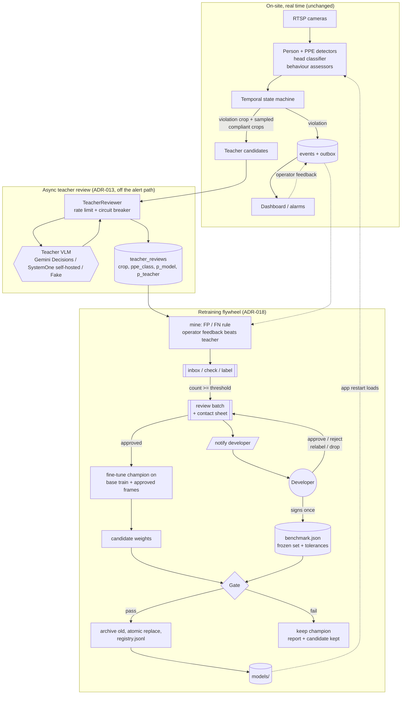
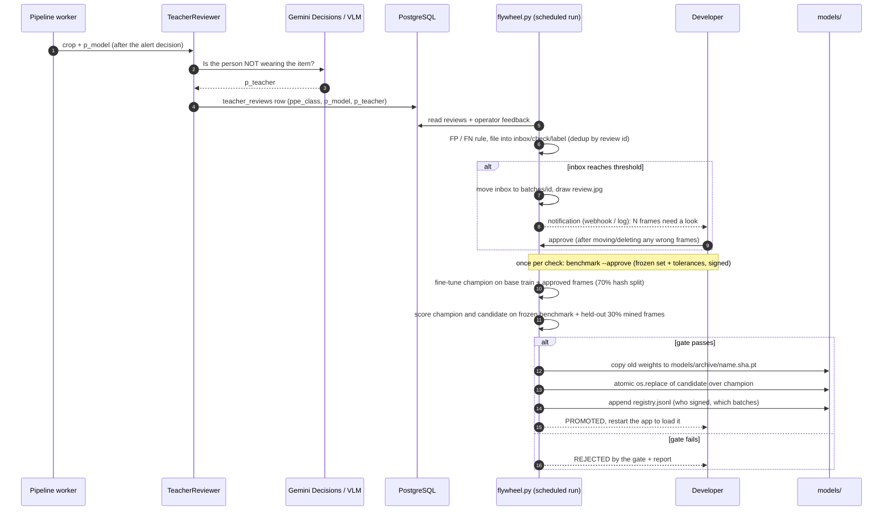
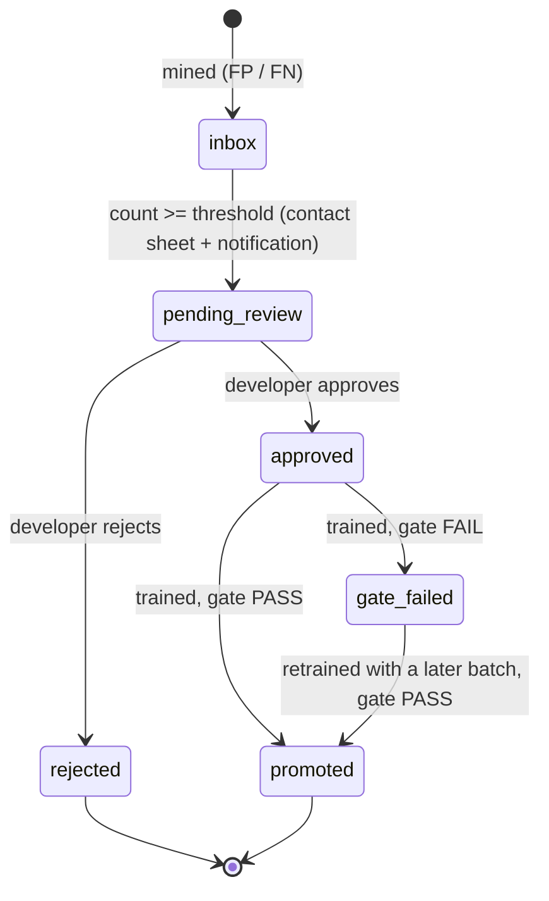

# Retraining Flywheel — VLM-mined mistakes → human-approved retraining → gated promotion

**Audience:** developers and engineering leadership · **Decision record:** [ADR-018](../decisions/ADR-018-retraining-flywheel.md)
· **Code:** [`scripts/ml/flywheel.py`](../../scripts/ml/flywheel.py) · **Config:** [`configs/flywheel.example.yaml`](../../configs/flywheel.example.yaml)

## 1. In one paragraph

Every site drifts. New helmet colours, a new uniform, winter hoods, different light, a camera moved two metres. A
model that was 97% accurate on its training data quietly gets worse on the site it watches. The flywheel turns the
system's own production traffic into a training signal. A strong vision-language model (the **teacher**: Google
Gemini Decisions, or any self-hosted VLM behind the same interface) re-checks a sample of the on-site decisions
**after** they are made. Wherever the teacher confidently disagrees with our model, the frame is a mined **false
negative** (a violation we missed) or a **false positive** (a false alarm). Mined frames are sorted per check and label.
When a check reaches the **threshold the developer set**, the developer is **notified** and reviews the batch once. Only
after their **approval** is the model fine-tuned on *old dataset + approved frames*. The new weights **replace the old
weights only if they pass a gate**: no regression on a **benchmark the developer signed**, and fewer errors on held-out
mined frames. Otherwise the champion stays, and the candidate and report are kept for inspection.

## 2. What already existed vs what this adds

| Capability | Before (ADR-013) | Flywheel (ADR-018) |
|---|---|---|
| VLM teacher reviews production crops (async, off the alert path) | ✅ `app/inference/teacher.py`, `app/services/teacher_review.py` | reused unchanged |
| Every review stored (crop, p_model, p_teacher, verdict) | ✅ `teacher_reviews` table | + `ppe_class` column (migration 0007) so mistakes sort per check |
| Operator feedback on alerts (TRUE/FALSE_POSITIVE) | ✅ `events.feedback` | used as ground truth that **beats** the teacher |
| Mine FP / FN per check, sorted into label folders, deduped | – | ✅ `flywheel.py mine` |
| User-set threshold → review batch + contact sheet + notification | – | ✅ console, `notifications.jsonl`, Slack/Teams webhook |
| Developer approve / reject (relabel = move a file, drop = delete it) | – | ✅ `approve` / `reject` |
| Developer-signed, hash-frozen benchmark + tolerances | – | ✅ `benchmark --approve` |
| Fine-tune on old data + approved frames | offline study only (`distill_finetune.py`) | ✅ `train` (same recipe, reused) |
| Champion/challenger gate → archive → atomic promote → registry | – | ✅ `train` |
| Unattended loop (schedule it) | – | ✅ `run` |

**Design principle:** reuse the existing teacher, storage, training recipe and split helpers. The flywheel is one
~400-line script plus one column, not a new service.

## 3. Architecture



**Three loops, three speeds:**

1. **Alert loop** (milliseconds): never touched by the teacher or the flywheel.
2. **Review loop** (seconds, async): the teacher can *add* signal (escalate a missed violation, tag a likely false
   alert). It can never suppress or edit an alert (ADR-013, proven by test).
3. **Learning loop** (days or weeks, human-gated): the flywheel.

## 4. End-to-end sequence



## 5. Batch lifecycle



Approved labels are never thrown away. `gate_failed` frames stay in the training pool and join the next training
run when a new batch is approved. A failed gate is a verdict on that *model*, not on the developer's labels.
`run` only retrains when there is a **newly** approved batch, so a failed gate does not cause a retraining loop.

## 6. The rules

### 6.1 Mining: what counts as a mistake

All probabilities are P(violation) (P(item missing), or P(behaviour happening)). The model "said violation" when `p_model ≥ 0.5`.

| Truth source (first that applies) | Truth | Model said | Mined as |
|---|---|---|---|
| Operator feedback `TRUE_POSITIVE` | violation | compliant | **FN** |
| Operator feedback `FALSE_POSITIVE` | compliant | violation | **FP** |
| Teacher `p_teacher ≥ 0.5 + margin` | violation | compliant | **FN** |
| Teacher `p_teacher ≤ 0.5 − margin` | compliant | violation | **FP** |
| Teacher unsure (`|p_teacher − 0.5| < margin`) | – | – | not mined |
| Truth agrees with the model | – | – | not mined |

The frame is filed under the label the truth says is correct (`no_helmet/FN_…jpg`, `helmet/FP_…jpg`). That makes each
batch an ImageFolder dataset as-is. `margin` (default 0.3) trades volume for label quality.

### 6.2 The gate: when may weights be overwritten?

The candidate is promoted only if **both** hold:

1. **No regression on the developer-approved benchmark.** For each metric the developer signed, the candidate must
   be no worse than the current champion within its tolerance: `accuracy`, `auroc` (higher is better), and
   `missed_violations_at_0.5`, `false_alarms_at_0.5` (lower is better). Default tolerance 0 = "at least the same".
2. **A real gain on what was mined.** On the **held-out 30%** of approved mined frames (never trained on, split by
   file-name hash), the candidate makes at least `mined_min_gain` fewer errors than the champion.

Integrity guards: `train` refuses to run without a signed `benchmark.json`, and refuses if the benchmark file set's
hash changed since signing. A mined crop that also sits in the benchmark is excluded from the benchmark for both
models, so nothing is scored on data it trained on. Both models are scored on the identical set.

### 6.3 Promotion

`copy old → models/archive/<name>.<sha12>.pt` **before** anything is written, then `os.replace` (atomic: a
reader sees the old file or the new file, never half of one), then one line in `models/registry.jsonl`
(time, check, old/new hash, archive path, batches, who signed the benchmark). **Rollback** is one copy:
`cp models/archive/<name>.<old-sha>.pt models/<name>` and a restart.

## 7. Coverage: every check in the system

The pipeline (mine → sort → threshold → notify → approve → gate → promote) is check-agnostic. What differs per check
is (a) whether the teacher sees that check today and (b) what kind of model, if any, there is to retrain.

| Check | Model behind it | Teacher reviews it today? | Trainer | Status |
|---|---|---|---|---|
| Hard hat | `head_cls_yolo26n.pt` crop classifier | ✅ head crops | `classify` | **Live end to end** (measured below) |
| Safety vest, gloves, goggles, safety shoes | `ppe_items_yolo26m.pt` detector | ✅ region crops (all PPE items) | `detect` | Mined, sorted, notified, approved today. Adapter not wired. |
| Phone use | `yolo26s.pt` COCO detector (class 67) | ❌ behaviours are not sent | `detect` | Needs behaviour candidates + adapter |
| Fight | `fight_gru.pt` pose-sequence GRU | ❌ | `sequence` | Needs a clip teacher (keyframe strip) + adapter |
| Fall | rule: pose geometry + duration | ❌ | `rule` | No weights. Mined misses tune thresholds. |
| Stalling, outside-time | rules: stillness timer / schedule + line crossing | ❌ | `rule` | No weights. Mined misses tune thresholds and schedules. |

**Why not "retrain everything" today (honest scoping):**

- **Detectors need boxes, not crop labels.** The teacher answers "is the vest missing in this crop?". It doesn't
  draw boxes. The `detect` adapter must turn (detector box + teacher yes/no) into YOLO label files on the full frame,
  so the full frame and box must be stored with the review. Crops alone are not enough.
- **One shared detector serves four checks.** A vest fix must not break gloves, so the benchmark for
  `ppe_items_yolo26m.pt` has to gate **all** its classes together.
- **Behaviours are temporal.** A fight or a fall cannot be judged from one crop. The teacher needs a short keyframe
  strip, so the `Teacher.review` interface grows from one image to a list.
- **Rules have no weights.** There is nothing to fine-tune for "outside allowed hours". The honest output of the
  flywheel there is a report of misses that tells the developer which threshold or schedule to change.

### 7.1 Trainer adapter contract (how a new check plugs in)

An adapter is three functions, selected by `trainer:` in the config:

| Function | `classify` (done) | `detect` (next) | `sequence` (next) |
|---|---|---|---|
| `build_dataset(base, approved_frames) → data` | ImageFolder hard-links | YOLO images + label txt from stored frame + box + label | `.npz` pose sequences from stored clips (`extract_fight_sequences.py`) |
| `fit(champion, data) → candidate` | `YOLO.train` (cls recipe) | `train_ppe_detector.py` recipe | `train_fight.py train` |
| `evaluate(weights, rows) → metrics` | per-crop metrics | per-class mAP + miss/false-alarm at the deployed conf | clip-level metrics (`train_fight.py eval`) |

Mining, batching, notification, approval, the gate and promotion are shared and need no change per adapter.

## 8. Measured: a real run on this repository

Run on 2026-11-25 on an RTX 3090. Source: **351 real Gemini Decisions answers** (cached by
`teacher_benchmark.py`) on public CC0 head crops. Champion: shipped `head_cls_yolo26n.pt`.

| Step | Result |
|---|---|
| Mine (margin 0.3) | **12** confident disagreements: **10 FN** (missed violations), **2 FP** (false alarms) |
| Teacher correctness on the mined frames (vs ground-truth folders) | **12 / 12** correct |
| Batch at threshold 10 → contact sheet + notification | ✅ |
| Benchmark signed | 2,378 frozen test crops. Champion: 97.27% acc, AUROC 0.9945, 53 missed, 12 false alarms. |
| Train (old 18,869 crops + 9 mined; 3 mined held out; 10 epochs) | 1.7 min train / ~3 min total, deterministic (two runs identical) |
| Gate, zero tolerance | misses **43 → 36**, AUROC 0.9953 → 0.9969, mined hold-out errors 3 → 2 (of 3), **but false alarms 10 → 15 → REJECTED** |
| Gate, developer accepts +5 false alarms | **PROMOTED**: archive, atomic replace, registry line. Then rolled back to keep the repo clean. |

The gate-time benchmark is the 2,366 crops left after excluding the 12 mined ones. That's why the champion's count
there is 43 misses / 10 false alarms rather than 53 / 12.

**What this shows:** the loop runs end to end on real teacher output, the mined labels were clean, and the gate
blocked a model that was better at the safety-critical metric but worse on false alarms until a human decided that
trade-off. **What it does not show:** site performance. Twelve mined frames is a mechanics demo, and these crops are
from the public split the champion was evaluated on. Real gains need weeks of site traffic (see ADR-013: distillation
at ~230 labels did not yet beat continued training).

## 9. Runbook

```powershell
cd backend
uv run python ../scripts/ml/flywheel.py status                              # every check: trainer, inbox/threshold, batches
uv run python ../scripts/ml/flywheel.py mine --source db                    # production: teacher_reviews + feedback
uv run python ../scripts/ml/flywheel.py benchmark --check hard_hat --approve --by <you>   # once; re-sign to change tolerances
uv run python ../scripts/ml/flywheel.py approve --check hard_hat --batch <id> --by <you> --note "looked at all"
uv run python ../scripts/ml/flywheel.py reject  --check hard_hat --batch <id> --by <you> --note "wrong camera"
uv run python ../scripts/ml/flywheel.py train   --check hard_hat [--epochs 10]
uv run python ../scripts/ml/flywheel.py run --source db                     # mine + train every newly approved check
uv run python ../scripts/ml/flywheel.py selftest                            # no GPU / DB needed
```

**Schedule** `run --source db` nightly (cron / Windows Task Scheduler), off-shift if the training GPU is the
live-inference GPU. **Notifications:** set `FLYWHEEL_WEBHOOK_URL` (Slack/Teams incoming webhook) in the environment.
It is never put in a config file. **After a promotion,** restart the app so it loads the new weights.

### 9.1 Interview demo script (~6 minutes)

Uses a demo config (`~/ppe-work/flywheel-demo.yaml`: the example config with `work_dir: ~/ppe-work/flywheel-demo` and
`threshold: 10` for hard_hat).

```powershell
cd backend
uv run python ../scripts/ml/flywheel.py --config $HOME/ppe-work/flywheel-demo.yaml status
uv run python ../scripts/ml/flywheel.py --config $HOME/ppe-work/flywheel-demo.yaml mine --source cache
```

Open the printed `review.jpg` (red = missed violations, blue = false alarms), then:

```powershell
uv run python ../scripts/ml/flywheel.py --config $HOME/ppe-work/flywheel-demo.yaml approve --check hard_hat --batch <id> --by developer
uv run python ../scripts/ml/flywheel.py --config $HOME/ppe-work/flywheel-demo.yaml benchmark --check hard_hat --approve --by developer
uv run python ../scripts/ml/flywheel.py --config $HOME/ppe-work/flywheel-demo.yaml train --check hard_hat --epochs 10
```

This shows the gate **rejecting** the candidate (false alarms 10 → 15) and the champion untouched. To show a
promotion, set `false_alarms_at_0.5: 5` in the demo config, re-sign the benchmark, and approve a new batch (or reset
the demo dir). Roll back with the archive copy in §6.3.

## 10. Files on disk

```
<work_dir>/                      (~/ppe-work/flywheel by default)
  notifications.jsonl            every notification, also when the webhook is down
  <check>/
    state.json                   seen review ids, batches {status, kinds, decided_by, decided_at, approved_counts}
    inbox/<label>/{FN|FP}_<id>.jpg + manifest.json      (below threshold)
    batches/<batch-id>/<label>/… + manifest.json + review.jpg
    benchmark.json               signed: approved_by, files_sha, tolerances, champion scores at signing
    runs/<run>/data, train/      hard-linked dataset + Ultralytics run (candidate = train/weights/best.pt)
    reports/<run>.json           gate lines, both models' metrics, hashes, overlap excluded
models/archive/<name>.<sha12>.pt every replaced champion
models/registry.jsonl            promotion audit log
```

## 11. Safety and security invariants

- The teacher and the flywheel are **never on the alert path**. A teacher outage or a training run cannot delay an alert.
- The teacher can **add** signal but never suppress, resolve or edit an alert (ADR-013).
- **No weights are overwritten without:** developer-approved frames, a developer-signed and hash-checked benchmark,
  and a passing gate. The old weights are archived first, the swap is atomic, and every promotion is logged.
- **Operator feedback beats the teacher.** A VLM label is a pre-label until a human has looked at it.
- **Privacy:** crops are privacy-masked before review. `teacher.enabled: false` by default. Free cloud tiers may
  use submitted data, so real site footage should go to the self-hosted SystemOne provider.
- **Secrets:** `GEMINI_API_KEY` is only in a request header and redacted in logs. The webhook URL is env-only.

## 12. Known limits and next steps

| Limit | Upgrade path |
|---|---|
| Only the `classify` adapter is wired | `detect` adapter (store frame + box per review), then `sequence` |
| Behaviours are not teacher-reviewed | Clip candidates + `Teacher.review(images: list)` |
| Weights load at app start | Hot-reload the classifier on a registry change |
| Gate is offline (frozen set) | Add a shadow run: the candidate scores live traffic beside the champion for N days before promotion |
| Teacher-label noise | Raise `margin`, require operator feedback for promotion, track teacher precision per site |
| Threshold counts frames, not diversity | Cap frames per camera/day so one noisy camera cannot fill a batch |
| Training competes with live inference on one GPU | Schedule off-shift, or a separate training GPU/host |

## 13. Is this approach unique? (prior art)

**Short answer: no. The pattern is established, and saying so is a strength.** What this implementation adds is a
specific combination of safety guardrails for an on-prem, safety-critical CV system.

| System | Mining trigger | Labeller | Human in loop | Promotion gate |
|---|---|---|---|---|
| **Tesla "data engine"** ([Karpathy, CVPR 2021](https://medium.com/self-driving-cars/andrej-karpathys-cvpr-talk-annotated-7a49d7529d2d), [summary](https://dynamicallytyped.com/stories/2021/karpathy-autopilot-cvpr/), [fleet-data patent](https://electrek.co/2020/03/23/tesla-patent-sourcing-self-driving-training-data/)) | shadow mode + 221 hand-written triggers on fleet disagreements | offline auto-labelling + humans | yes | unit tests built from past failures |
| **Google MLOps level 1–2** ([architecture guide](https://docs.cloud.google.com/architecture/mlops-continuous-delivery-and-automation-pipelines-in-machine-learning), [practitioners' guide](https://services.google.com/fh/files/misc/practitioners_guide_to_mlops_whitepaper.pdf)) | schedule, new-data volume, or drift | existing labels | optional | model validation before registry/deploy |
| **NVIDIA Data Flywheel Blueprint** ([blueprint](https://build.nvidia.com/nvidia/build-an-enterprise-data-flywheel/blueprintcard), [glossary](https://www.nvidia.com/en-us/glossary/data-flywheel/)) | production logs of LLM agents | none (no labelling step) | **no** human curation | evaluation vs latency/cost/accuracy criteria |
| **Roboflow Autodistill + active learning** ([Autodistill](https://blog.roboflow.com/autodistill/), [one-command pipeline](https://blog.roboflow.com/label-train-deploy-autodistill/), [overview](https://labelyourdata.com/articles/data-annotation/autodistill)) | low-confidence predictions | foundation model (Grounding DINO, Florence-2…) labels everything | validates pre-labels | not built in |
| **Champion/challenger practice** ([example write-up](https://datarekha.com/blog/dont-auto-ship-retrained-models-collapse/)) | – | – | – | data checks, offline tests, shadow, canary |
| **This flywheel** | VLM **disagrees with the deployed model** on its own production traffic + operator feedback | VLM verdict, operator feedback wins | **yes, mandatory**, once per batch | signed, hash-frozen benchmark (no regression) **and** a gain on held-out mined failures, with archive + atomic swap + audit log |

**What is genuinely distinctive here** (a combination, not an invention):

1. The VLM is a **verifier of the deployed model's decisions**, not a bulk labeller. It only produces labels where it
   confidently disagrees, so a human reviews a dozen frames, not thousands.
2. **Asymmetric safety:** the same teacher that mines training data can escalate a missed violation live, but can
   never suppress an alert.
3. **A two-sided gate:** "don't get worse on what we already know" (a developer-signed, tamper-evident benchmark) plus
   "prove you fixed what we mined" (held-out mined failures), with a per-metric tolerance so the false-alarm vs
   missed-violation trade-off is an explicit, logged human decision.
4. **On-prem and per check:** thresholds, labels and trainers per check, a self-hostable teacher, and nothing leaves
   the site unless configured.

Every part has precedent. Combining them for workplace-safety CV with a human sign-off at both the data step and the
benchmark step is less common in public write-ups. That is the defensible claim; "nobody has done this" is not.
