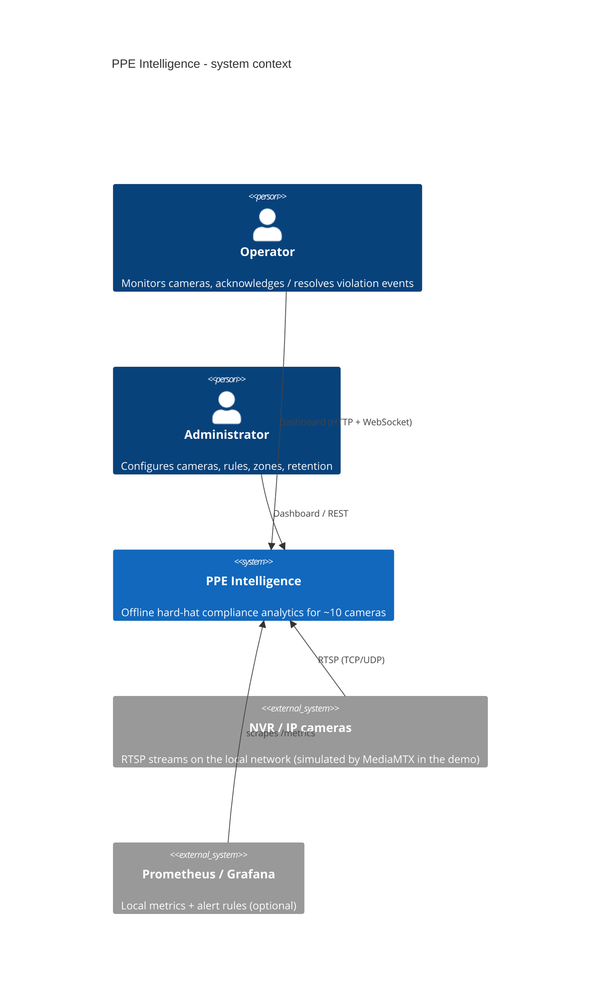

# 00 - System context

**Status:** VERIFIED (demo deployment) · **Related ADRs:** ADR-001, ADR-011 · **Modules:** whole system

## Purpose and scope
Who and what interacts with PPE Intelligence.

## Assumptions
- Single site (ship / plant), ~10 RTSP cameras behind a local NVR, no internet at runtime (FR-OFF-001).
- In the demo the NVR is MediaMTX fed by looped stock clips; this is labelled in the UI.

## Diagram

Source: [`diagrams/system-context.mmd`](diagrams/system-context.mmd)

## Component responsibilities
| Actor / system | Responsibility |
|---|---|
| Operator | watches the camera wall, reviews evidence, acknowledges/resolves events, gives TP/FP feedback |
| Administrator | cameras, rules, zones, retention, users, demo controls |
| NVR / cameras | deliver RTSP; may disconnect, stall or degrade at any time |
| Prometheus/Grafana | optional local monitoring and alert rules |

## Interfaces / contracts
RTSP (in), HTTP/WebSocket dashboard (out), Prometheus text format (out). See [10](10-api-and-websocket-contracts.md).

## Data ownership
PPE Intelligence owns events, evidence, configuration and audit data; cameras own the video (never recorded continuously).

## Concurrency / process boundaries
See [01](01-container-architecture.md).

## Failure modes
Camera/NVR faults and host faults are covered in [14](14-failure-modes-and-recovery.md).

## Security / privacy
No face recognition, no identity data, evidence by opaque id only. No credentials leave the worker: stream URIs are stored credential-free and resolved from `env:` references at connect time; every stream error passes `core.redaction.redact()`.

## Performance implications
10 streams × 5 processed FPS = 50 inference frames/s target; measured in [15](15-capacity-planning-and-performance.md).

## Alternatives considered
Cloud inference (rejected: offline requirement, FR-OFF-002).
