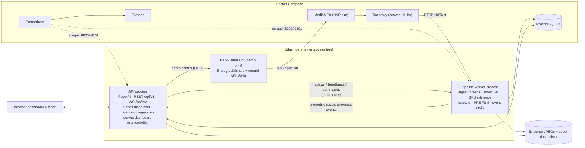

# 01 - Container architecture

**Status:** VERIFIED · **Related ADRs:** ADR-001, ADR-010, ADR-011 · **Modules:** `backend/app/main.py`, `backend/app/workers/*`, `docker-compose.yml`

## Purpose and scope
Deployable units and how they talk.

## Assumptions
- GPU inference runs natively on the host (Windows dev box); stateful services run in Docker Compose.

## Diagram

Source: [`diagrams/container-architecture.mmd`](diagrams/container-architecture.mmd)

## Component responsibilities
| Container / process | Responsibility |
|---|---|
| API process | REST, WebSocket, outbox delivery, retention, worker supervision, demo simulator management, static dashboard |
| Pipeline worker | all CV work and event creation; restarted by the API on crash/heartbeat loss |
| PostgreSQL | durable configuration, events, outbox, audit |
| MediaMTX + Toxiproxy | simulated NVR and network fault injection (demo/test only) |
| Prometheus + Grafana | metrics storage, alert rules, dashboards |

## Interfaces / contracts
`multiprocessing` queues (telemetry, commands - `workers/telemetry.py`), SQL, HTTP. Worker metrics on :9101, API on :8000.

## Data ownership
Worker writes events/evidence/camera health history; API writes configuration, actions, users, outbox delivery state.

## Concurrency / process boundaries
Two processes (spawn). Inside the worker: N source threads, watchdog, inference, event service, telemetry. API: asyncio + threadpool.

## Failure modes
Worker death never takes the API down; DB outage never stops inference ([14](14-failure-modes-and-recovery.md)).

## Security / privacy
API binds to 127.0.0.1 by default; put a reverse proxy with TLS in front for LAN access. No credentials leave the worker: stream URIs are stored credential-free and resolved from `env:` references at connect time; every stream error passes `core.redaction.redact()`.

## Performance implications
Only small JSON + ~30-60 KB preview JPEGs cross the process boundary (≤ 4/s per camera).

## Alternatives considered
Microservices with a broker; one process per camera (ADR-001).
