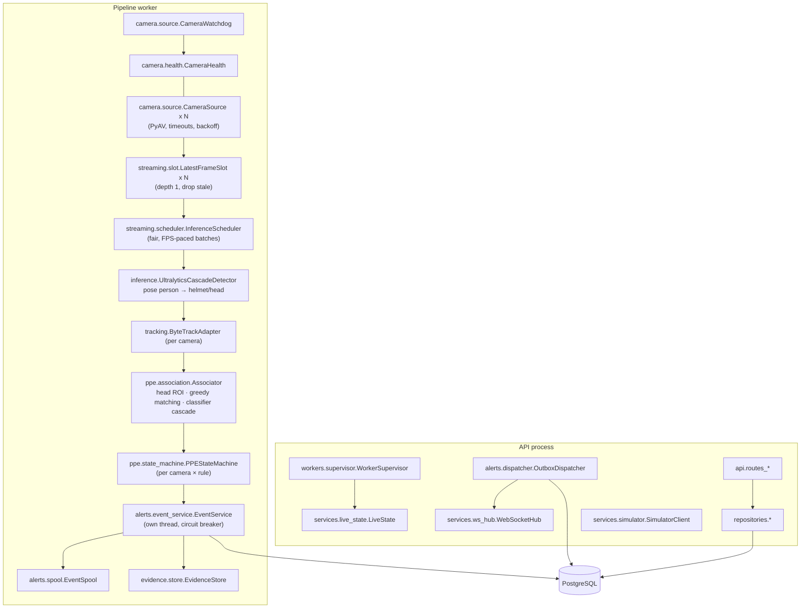

# 02 - Component architecture

**Status:** VERIFIED · **Related ADRs:** ADR-002..006 · **Modules:** `backend/app/*`

## Purpose and scope
Module-level structure inside the two processes.

## Assumptions
- Replaceable adapters: detector (`inference/types.Detector`), tracker (`tracking.PersonTracker`), source (`camera.source`), storage (repositories).

## Diagram

Source: [`diagrams/component-architecture.mmd`](diagrams/component-architecture.mmd)

## Component responsibilities
See the diagram; each box names its module. Contracts are listed in [implementation-plan §4](../implementation-plan.md).

## Interfaces / contracts
`Frame`, `Detection`, `FrameDetections`, `TrackedPerson`, `Observation`, `Transition` (dataclasses), `ConfirmedViolation` (event service input).

## Data ownership
Trackers and state machines are owned by the inference thread (no locks); episode/dedupe state by the event-service thread.

## Concurrency / process boundaries
Cross-thread hand-offs only through `LatestFrameSlot` (Condition), the event queue (bounded) and telemetry queue (bounded).

## Failure modes
A failed batch is skipped and counted; a failed frame is logged and skipped; nothing kills the inference thread.

## Security / privacy
Privacy masks are applied before evidence/preview encoding. No credentials leave the worker: stream URIs are stored credential-free and resolved from `env:` references at connect time; every stream error passes `core.redaction.redact()`.

## Performance implications
Detector stages batched across cameras; association is pure Python (≈1 ms/frame).

## Alternatives considered
`model.track(persist=True)` (rejected - one tracker state per predictor would mix cameras, ADR-004).
