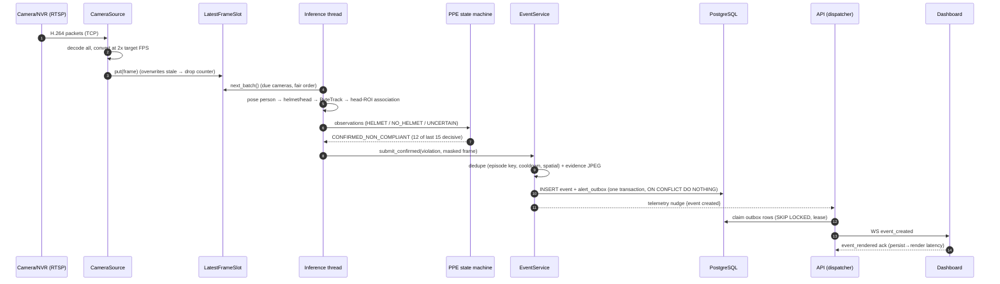

# 03 - Runtime data flow (RTSP frame → confirmed alert)

**Status:** VERIFIED · **Related ADRs:** ADR-006, ADR-009 · **Modules:** `camera/source.py` → `alerts/dispatcher.py`

## Purpose and scope
End-to-end path and the latency boundaries that are measured.

## Assumptions
- Host clock is the single time base (camera clocks untrusted) → latencies are host-ingest-to-X.

## Diagram

Source: [`diagrams/runtime-sequence.mmd`](diagrams/runtime-sequence.mmd)

## Component responsibilities
Numbered in the sequence diagram.

## Interfaces / contracts
Timestamps captured: `Frame.captured_at/mono` (decode), inference start (frame age), `first_seen_at`, `confirmed_at`,
`persisted_at`, `dashboard_rendered_at` (client ack). Exposed per event (`latency.*`) and as histograms.

## Data ownership
Events are created only by the worker; status changes only by the API.

## Concurrency / process boundaries
Inference → event service (thread queue) → DB → API dispatcher (DB poll + telemetry nudge) → WebSocket.

## Failure modes
If the nudge is lost, the dispatcher's 1 s poll still delivers; if the API is down, outbox rows wait (durable).

## Security / privacy
Evidence leaves the host only via the authenticated evidence route.

## Performance implications
Measured boundaries: frame age at inference; time to confirm (policy-dominated: ≥ (12 - 1)/5 = 2.2 s at 5 FPS);
frame→persisted; persisted→rendered. Values: [15](15-capacity-planning-and-performance.md).

## Alternatives considered
Pushing events directly over telemetry to the WS (rejected: not durable, FR-ALT-009).
