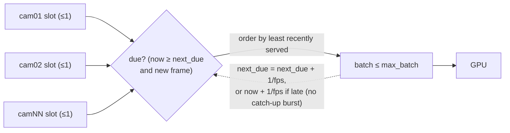

# 05 - Multi-camera scheduling and backpressure

**Status:** VERIFIED · **Related ADRs:** ADR-001 · **Modules:** `streaming/slot.py`, `streaming/scheduler.py`

## Purpose and scope
Fair, bounded, FPS-paced inference across cameras (NFR-PERF-006, spec 11.3).

## Assumptions
- Live monitoring prefers the newest frame over completeness.

## Diagram

## Component responsibilities
`LatestFrameSlot` keeps one frame; overwriting an unconsumed frame increments `camera_frames_dropped_total` (by design).
`InferenceScheduler` picks due cameras fairly and paces each at its target FPS.

## Interfaces / contracts
`next_batch(timeout) -> list[Frame]`; per-camera target FPS can change at runtime.

## Data ownership
Frames are owned by the slot until taken; nothing else retains full-resolution frames after processing.

## Concurrency / process boundaries
One shared `threading.Condition`; waits use real time even with injected clocks (bug found in unit tests).

## Failure modes
Overload → frames dropped and frame age rises (visible), never an unbounded queue.

## Security / privacy
n/a.

## Performance implications
Queue depth 0-1 per camera; frame age at inference p95 measured ≈0.12-0.14 s at 10×5 FPS ([15](15-capacity-planning-and-performance.md)).

## Alternatives considered
FIFO queues (rejected: latency grows under load); max-wait batching (implemented, default off - not needed at this load).
