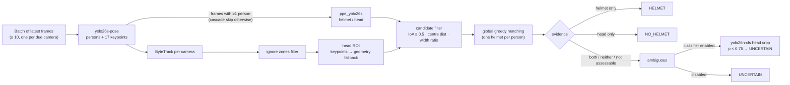

# 06 - Computer-vision pipeline

**Status:** VERIFIED · **Related ADRs:** ADR-003, ADR-005 · **Modules:** `inference/*`, `ppe/association.py`

## Purpose and scope
Cascaded models and why each exists (spec 6.5).

## Assumptions
- Person detection by a COCO pose model; helmet/head by a model fine-tuned on Hard Hat Workers (CC0).

## Diagram

Source: [`diagrams/inference-data-flow.mmd`](diagrams/inference-data-flow.mmd)

## Component responsibilities
| Stage | Model | Runs on | Why |
|---|---|---|---|
| Person + keypoints | yolo26s-pose (COCO) | every processed frame | robust person boxes + head keypoints for the ROI |
| Helmet / bare head | ppe_yolo26s (fine-tuned) | frames with ≥1 person | explicit positive evidence for both outcomes |
| Head-crop classifier | head_cls_yolo26n | ambiguous persons only | resolves conflicts without running on everyone |

## Interfaces / contracts
`Detector.detect(frames) -> list[FrameDetections]`; `HeadClassifier.classify(crops)`; `models.backend: mock` for GPU-less tests.

## Data ownership
Weights in `models/` (Git LFS), versions recorded per event and in `model_versions`.

## Concurrency / process boundaries
Inference thread only; FP16 on CUDA.

## Failure modes
Batch exceptions skipped and counted; CUDA OOM → cache emptied, repeated OOM → worker restart.

## Security / privacy
No face/identity models. Masks applied before any image leaves the worker.

## Performance implications
Ablations (coco+geometry vs pose+geometry vs pose+keypoints vs full cascade) in [15](15-capacity-planning-and-performance.md).

## Alternatives considered
YOLO-OBB for helmets (rejected without evidence of tilt failures - ADR-003); classifier on every person (cost).
