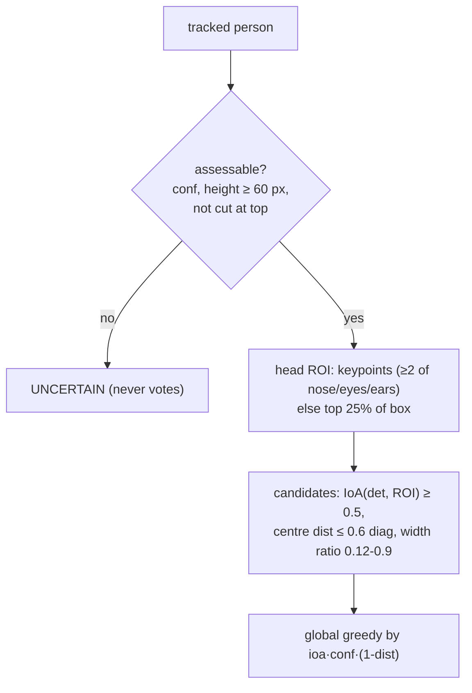

# 07 - Person tracking and PPE association

**Status:** VERIFIED (unit-tested; field accuracy not established) · **Related ADRs:** ADR-004, ADR-005 · **Modules:** `tracking/tracker.py`, `ppe/head_roi.py`, `ppe/association.py`, `ppe/zones.py`

## Purpose and scope
Per-camera identities and the helmet-is-on-this-head decision (FR-DET-003/004/007, FR-TRK-001/002).

## Assumptions
- Static cameras; no cross-camera Re-ID (not required).

## Diagram

## Component responsibilities
`ByteTrackAdapter` (Ultralytics BYTETracker, one per camera, IDs local to camera+worker run).
`Associator` implements the visibility gate, ROI, candidate filter, greedy matching, outcome and classifier cascade.

## Interfaces / contracts
`Associator.assess(persons, detections, frame) -> list[Observation]`.

## Data ownership
Track state per camera, discarded on worker restart (episode ids include the run id).

## Concurrency / process boundaries
Inference thread.

## Failure modes
ID switches → duplicate events; mitigated by head-position spatial dedupe (found necessary in live runs: person-box IoU
across occlusion was only 0.2-0.3 for the same person).

## Security / privacy
Track ids are anonymous counters.

## Performance implications
Tracking ≈2 ms/frame, association ≈1 ms/frame (p95, [15](15-capacity-planning-and-performance.md)).

## Alternatives considered
BoT-SORT/ReID; IoU-with-person-box association (fails for helmet in hand).
