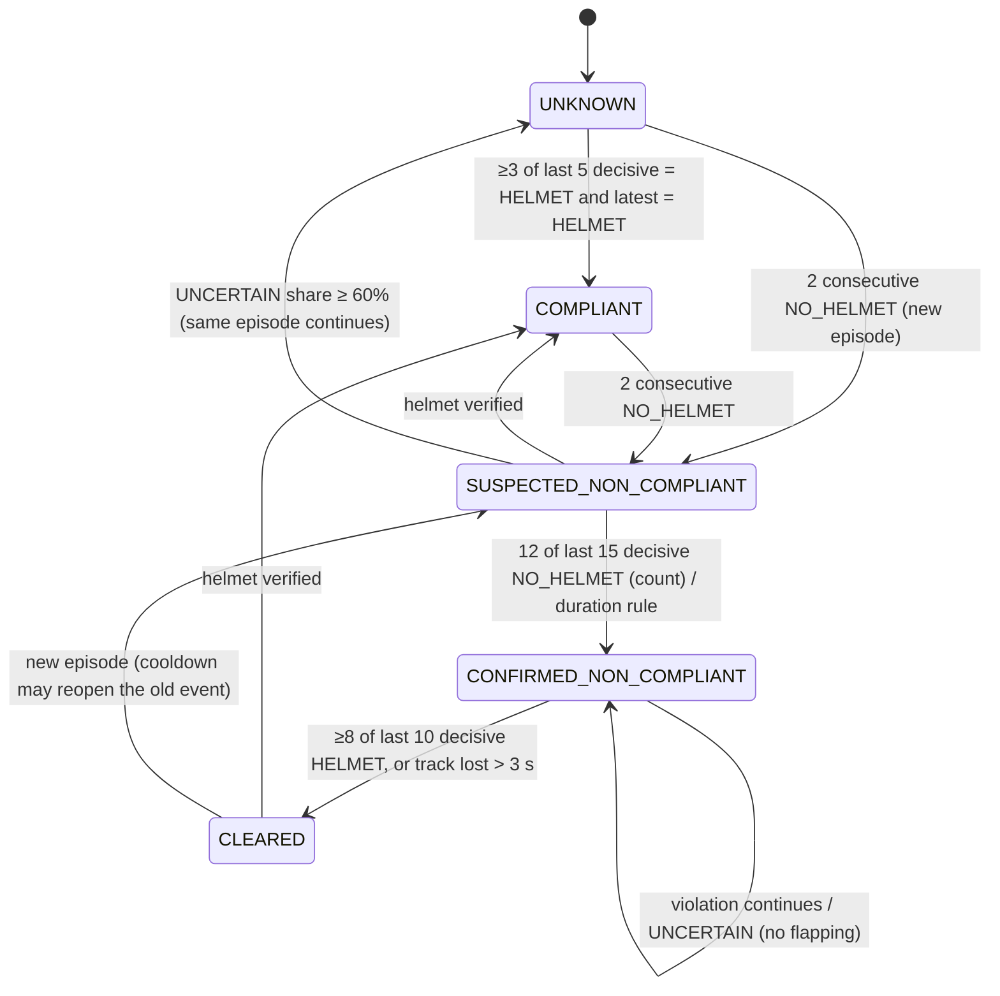

# 08 - PPE state machine and alert semantics

**Status:** VERIFIED · **Related ADRs:** ADR-006, ADR-013 · **Modules:** `ppe/state_machine.py`, `alerts/event_service.py`, `inference/teacher.py`, `services/teacher_review.py`, `repositories/events.py`

## Purpose and scope
When a violation becomes an alert, and how alerts are deduplicated (FR-TRK-004..008, FR-ALT-001..009).
Phase 3 (ADR-014): one state machine per (camera, rule) and per item - the votes below are that rule's item
(PRESENT/ABSENT, formerly HELMET/NO_HELMET). A rule's `mandatory` flag decides delivery: mandatory -> event +
outbox (live alert); secondary -> the same event row tagged `secondary` with NO outbox rows (Events list only).
Operator presets apply a named item->mandatory/secondary map to a scope as rule sets (ADR-014 2a).

## Assumptions
- Baseline policy 12 of 15 decisive observations (interview: 10-15 frames).

## Diagram

Source: [`diagrams/ppe-state-machine.mmd`](diagrams/ppe-state-machine.mmd)

## Component responsibilities
- State machine per (camera, rule): states and transitions in the diagram; `UNCERTAIN` never votes; hysteresis on clear.
- Event service: idempotency key `sha256(camera|track|zone|rule|episode)` with `episode = run:camera:track:seq`;
  cooldown (60 s) reopens the same event; spatial dedupe (30 s, person IoU ≥ 0.3 **or** head distance ≤ 0.75 head widths)
  merges ID switches; one transaction inserts event + outbox rows.
- Lifecycle `OPEN → ACKNOWLEDGED → RESOLVED` (resolve also allowed from OPEN), every action audited in `event_actions`.
- Teacher review (ADR-013, off by default): after confirmation, the API process asynchronously reviews the
  privacy-masked head crop — every confirmed violation plus a rate-limited sample of COMPLIANT tracks. Verdicts are
  asymmetric: ESCALATE a missed violation (new event via the normal path) or tag LIKELY_FALSE_ALERT (review row
  only); no code path can suppress, resolve or edit an alert (grid + SQL-capture tests).

## Interfaces / contracts
REST lifecycle endpoints in [10](10-api-and-websocket-contracts.md); `effective_confirm_seconds` exposed per rule.

## Data ownership
Episode state in the event-service thread; event rows in PostgreSQL.

## Concurrency / process boundaries
Event service thread with bounded queue and DB circuit breaker (5 s) so the GPU loop never waits on the DB.

## Failure modes
Duplicate replay → no duplicate (unique key, verified by test); DB down → spool; cooldown/dedupe state re-seeded from recent events on worker restart (person-box IoU only; empty if the DB is down at start).

## Security / privacy
Events contain no identity; feedback labels are evaluation metadata only.

## Performance implications
Time to confirm ≥ 2.2 s at 5 FPS by design; per-FPS values in [15](15-capacity-planning-and-performance.md).

## Alternatives considered
Consecutive-frame counter; EMA score.
