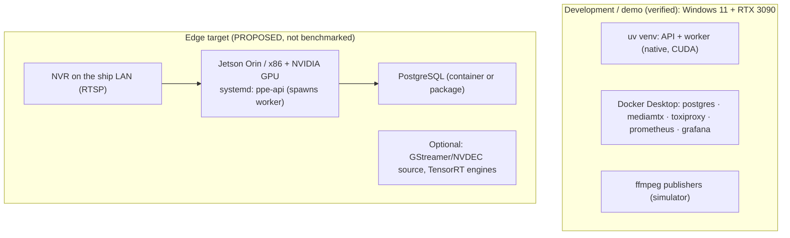

# 11 - Deployment topology

**Status:** VERIFIED (dev host) / PROPOSED (edge) · **Related ADRs:** ADR-011 · **Modules:** `docker-compose.yml`, `scripts/start_demo.py`, `deployments/`

## Purpose and scope
Where things run in development and on an edge box.

## Assumptions
- No benchmark on Jetson/Orange Pi exists; edge numbers must be measured on the device.

## Diagram

Source: [`diagrams/deployment-topology.mmd`](diagrams/deployment-topology.mmd)

## Component responsibilities
`scripts/start_demo.py` reproduces the dev topology from a clean clone; `deployments/linux` documents a systemd setup.

## Interfaces / contracts
Ports: 8000 API/dashboard, 9101 worker metrics, 5432 PostgreSQL, 8554 RTSP, 18501-18510 cameras via Toxiproxy,
8474 Toxiproxy API, 8890 simulator control, 9090 Prometheus, 3000 Grafana.

## Data ownership
`evidence/`, `spool/`, `models/` on the host disk; DB in a named Docker volume.

## Concurrency / process boundaries
See [01](01-container-architecture.md).

## Failure modes
Compose services restart `unless-stopped`; API should run under systemd/NSSM with restart on failure.

## Security / privacy
Bind to localhost or front with TLS; secrets only in `.env` (git-ignored).

## Performance implications
Desktop RTX 3090 numbers are not edge numbers.

## Alternatives considered
App container with GPU passthrough (possible on Linux; not needed for the demo).
