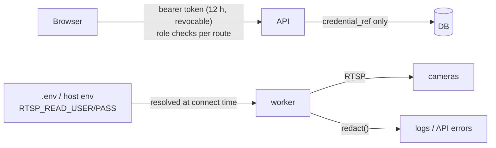

# 12 - Security and privacy boundaries

**Status:** VERIFIED (tests)  · **Related ADRs:** ADR-012 · **Modules:** `core/redaction.py`, `camera/uri.py`, `api/deps.py`, `repositories/users.py`

## Purpose and scope
Trust boundaries and controls (spec 14).

## Assumptions
- Single-site LAN deployment; operators are trusted employees; the threat model is in [16](16-threat-model.md).

## Diagram

## Component responsibilities
- Credentials: stored as `env:PREFIX` references; stream URIs with `user:pass@` are rejected (422).
- Redaction: URL userinfo, `password=`/`token=` pairs and every registered secret value masked in logs and errors.
- AuthN/Z: argon2id, opaque tokens (sha256 at rest), roles viewer/operator/admin, login rate limit 5/min/IP.
- Evidence: served by event id only; path traversal rejected (test).
- Privacy: no face recognition, no names, privacy zones pixelated in evidence and previews, retention job.

## Interfaces / contracts
`/api/v1/auth/*`, role dependencies `require("operator"|"admin")`.

## Data ownership
Only the worker process ever holds resolved camera credentials.

## Concurrency / process boundaries
Secrets never cross the process boundary (worker resolves its own env).

## Failure modes
DB outage: tokens validated in the last 5 minutes stay valid (read-mostly degraded mode).

## Security / privacy
Covered above. Known gaps: no TLS termination built in; single admin seeded from `.env`.

## Performance implications
argon2 verification ≈ tens of ms per login only.

## Alternatives considered
JWT (not revocable), Vault (not needed offline single node).
