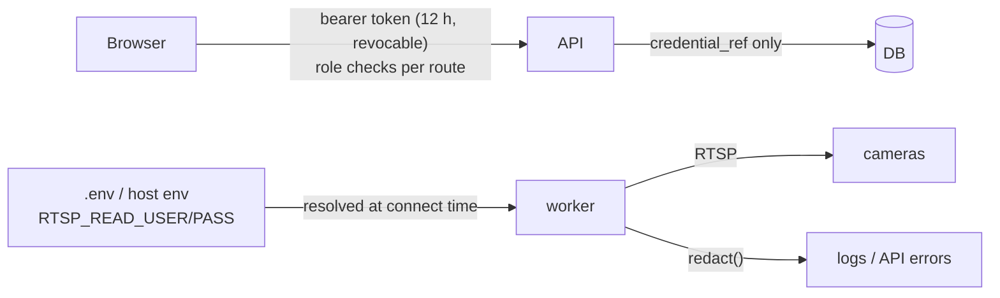

# 12 - Security and privacy boundaries

**Status:** VERIFIED (tests)  · **Related ADRs:** ADR-012, ADR-013 · **Modules:** `core/redaction.py`, `camera/uri.py`, `api/deps.py`, `repositories/users.py`, `inference/teacher.py`

## Purpose and scope
Trust boundaries and controls (spec 14).

## Assumptions
- Single-site LAN deployment; operators are trusted employees; the threat model is in [16](16-threat-model.md).

## Diagram

## Component responsibilities
- Credentials: stored as `env:PREFIX` references; stream URIs with `user:pass@` are rejected (422).
- Redaction: URL userinfo, `password=`/`token=` pairs and every registered secret value masked in logs and errors.
- AuthN/Z: argon2id, opaque tokens (sha256 at rest), roles viewer/operator/admin, login rate limit 5/min/IP.
- Evidence: served by event id only; path traversal rejected (test).
- Privacy: no face recognition, no names, privacy zones pixelated in evidence and previews, retention job.
- Teacher review (ADR-013, disabled by default): when enabled, privacy-masked head crops are sent to the configured
  provider; the Gemini key is a redacted `SecretStr` used only in the request header. Free-tier terms let the
  provider use submitted data — a site must only enable providers whose data terms it accepts (self-hosted
  SystemOne/Clef keeps crops on site).

## Interfaces / contracts
`/api/v1/auth/*`, role dependencies `require("operator"|"admin")`.

## Data ownership
Only the worker process ever holds resolved camera credentials.

## Concurrency / process boundaries
Secrets never cross the process boundary (worker resolves its own env).

## Failure modes
DB outage: tokens validated in the last 5 minutes stay valid (read-mostly degraded mode).

## Security / privacy
Covered above. Known gaps: no TLS termination built in; single admin seeded from `.env`.

### Phase 4 behaviour checks - Gulf deployment checklist (ADR-015)
Behaviour events (fall, fight, phone use during work hours, stalling) describe **people**, so they carry more legal
weight than a missing helmet. Before enabling them at a site:
- **Legal basis:** employee monitoring needs a documented, counsel-confirmed basis. UAE: Federal Decree-Law 45/2021
  (PDPL); KSA: PDPL (Royal Decree M/19) - both restrict processing employee data and require a stated purpose. DIFC
  (DP Law 5/2020) and ADGM (DPR 2021) free zones have their own regimes; confirm which applies per site.
- **Notice:** visible signage at monitored areas plus written notice to staff, naming the checks enabled and their
  purpose (safety, not performance scoring).
- **Purpose limitation:** an alert with evidence for a human to review, never an automated judgement or a
  disciplinary record. Fall/fight are safety signals; phone/stalling are policy - report them separately.
- **Proportionality:** scope phone/stalling rules to work-area zones and shift schedules (per-rule `schedule`); off
  shift the rule emits no observations at all.
- **Retention:** the same `evidence_retention_days` policy as PPE; deleted on schedule.
- **Access:** evidence served by id only; no face identification and no biometric template is stored - pose
  keypoints and boxes are dropped after assessment.

## Performance implications
argon2 verification ≈ tens of ms per login only.

## Alternatives considered
JWT (not revocable), Vault (not needed offline single node).
