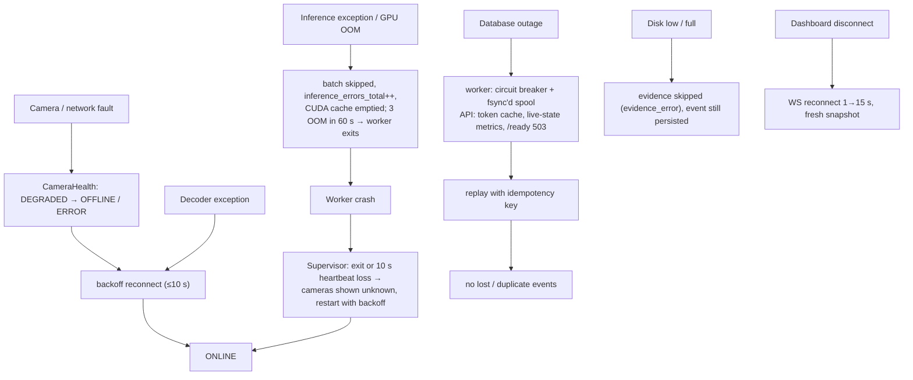

# 14 - Failure modes and recovery

**Status:** VERIFIED (fault-injection campaign) · **Related ADRs:** ADR-001, ADR-002, ADR-007 · **Modules:** see diagram

## Purpose and scope
What fails, how it is detected, how it recovers (spec 11.5).

## Assumptions
- Faults injected for real: simulator processes, Toxiproxy, docker stop, worker fault commands.

## Diagram

Source: [`diagrams/failure-recovery-flow.mmd`](diagrams/failure-recovery-flow.mmd)

## Component responsibilities
| Fault | Detection | Recovery | Evidence |
|---|---|---|---|
| camera unplugged / NVR path missing | EOF / 404 → OFFLINE | backoff ≤ 10 s | fault_injection.md |
| stalled stream | frame age → DEGRADED → OFFLINE, decode-rate rule | reconnect | fault_injection.md |
| RTSP timeout / refused | read timeout / InvalidDataError → OFFLINE | reconnect | fault_injection.md |
| invalid credentials | CredentialError / 401 → ERROR (reason shown) | fix config | fault_injection.md |
| decoder exception | → RECOVERING | reconnect | fault_injection.md |
| inference exception / GPU OOM | `inference_errors_total` | next batch | fault_injection.md |
| worker crash | supervisor (exit / heartbeat) | respawn | fault_injection.md |
| DB outage | `/ready` 503, DB banner, `db_up=0` | spool replay, no duplicates | fault_injection.md + integration test |
| disk full | `ppe_evidence_failures_total` | event kept, evidence_error | fault_injection.md + unit test |
| WS disconnect | client | reconnect + snapshot | unit test |
| app restart | - | migrations + persisted config/events | manual run |

## Interfaces / contracts
Demo/test fault API: `POST /api/v1/system/faults`, `/api/v1/demo/*`, simulator CLI.

## Data ownership
Spool `spool/events.jsonl` (fsync'd) until replayed.

## Concurrency / process boundaries
Faults in one camera thread never block others (measured: unaffected cameras stayed at ~5 FPS).

## Failure modes
Known limits: constant added network latency is invisible without source timestamps; cooldown/dedupe memory is lost on
worker restart (possible duplicate alert after a crash).

## Security / privacy
Fault API disabled outside demo mode unless `PPE_ENABLE_FAULT_INJECTION=1`.

## Performance implications
See measured detection/recovery times.

## Alternatives considered
Watchdog that closes containers cross-thread (rejected - native crash risk).
